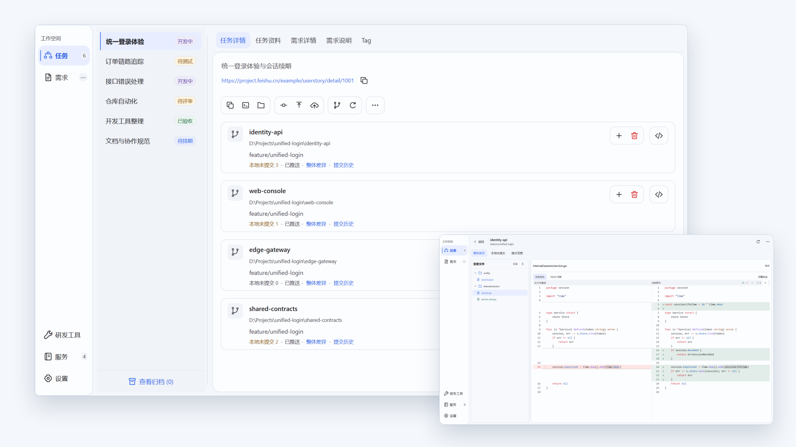
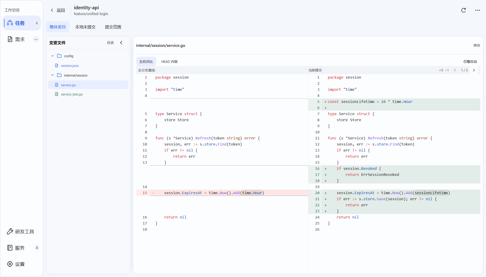
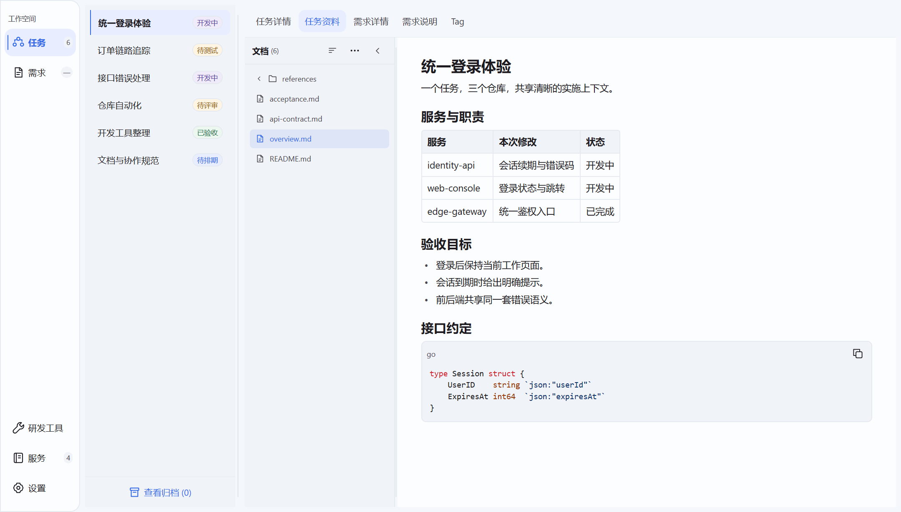

<h1 align="center">
  <picture>
    <source media="(prefers-color-scheme: dark)" srcset="docs/assets/readme-brand-dark.png">
    
  </picture>
</h1>

<strong>A native multi-repository development workspace built in Go with <a href="https://github.com/egoist/mygo">MyGO</a> (no webview, no Electron).</strong>

  <a href="https://github.com/javatoai/silverwing/releases"><strong>Download</strong></a> &nbsp;·&nbsp;
  <a href="#tour">Tour</a> &nbsp;·&nbsp;
  <a href="#get-started">Get started</a> &nbsp;·&nbsp;
  <a href="#license">License</a> &nbsp;·&nbsp;
  <a href="README.md">简体中文</a>

  <picture>
    <source media="(prefers-color-scheme: dark)" srcset="docs/assets/readme-banner-dark.png">
    
  </picture>

Silverwing is a small multi-repository development workspace written in Go, with a native desktop UI built on <a href="https://github.com/egoist/mygo">MyGO</a>. It does not depend on a WebView, Electron or a JVM. 
Packaged downloads are about 18 MB. Keep tasks, repositories, branches and materials organized, with built-in Git review and everyday developer tools.

One feature often spans several services. Silverwing brings their workspaces into one task, so you can move between code, requirements, documents and your coding tools without losing the context.

> Silverwing is under active development. Some features and platform behavior still need further validation.

## Features

- **Task workspaces:** organize multiple repositories and modules under one task, using Git Worktrees or independent clones.
- **Task navigation:** search by task name, requirement ID, project group or branch, with pinned tasks always shown first.
- **Git review:** inspect committed changes against the configured mainline, local uncommitted files or a commit range, with a changed-file tree and side-by-side diffs.
- **Agent context:** combine global, group and task instructions into generated `AGENTS.md` context, and open the right workspace in Codex, Cursor or your IDE.
- **Task materials:** browse local files and read Markdown, PDF, images, tables and diagrams; find text, inspect source and follow document links.
- **Skills and Codex configuration:** browse local Skills, manage Git-based Skill sources and Codex plugins, and inspect MCP configuration.
- **Developer tools:** format and fold JSON, convert dates and timestamps, compare text side by side, and optionally inspect local port usage.
- **Connected workflows:** bring in Meegle requirements and comments, sync selected materials to Lark, and track task Tag delivery with optional Genbu status.
- **Local workspace management:** keep configuration and task records on disk, switch between light and dark themes, and archive tasks while retaining their workspaces.

## Tour

<table>
  <tr>
    <td width="50%" valign="top"><strong>Repositories and services</strong> 
      Organize local repositories and service modules by project group.  
      </td>
    <td width="50%" valign="top"><strong>Git review</strong> 
      Explore changed files and read old and new code side by side.  
      </td>
  </tr>
  <tr>
    <td valign="top"><strong>Task materials</strong> 
      Keep design notes, reference documents and implementation context beside the task.  
      </td>
    <td valign="top"><strong>Developer tools</strong> 
      Work with JSON, timestamps and text comparisons inside the same desktop app.  
      </td>
  </tr>
</table>

Screenshots use example data on Windows. The application interface is currently in Chinese; both README versions share the same screenshots.

## Get started

### Download

Download published packages from [GitHub Releases](https://github.com/javatoai/silverwing/releases), or follow the [source build instructions](docs/RELEASE.md) to build locally. These packages are supported:

| Platform | Package |
| --- | --- |
| Windows x64 | Setup EXE, MSI or portable ZIP |
| macOS Apple silicon (arm64) | DMG |

For the Windows portable version, extract the entire archive and run `silverwing/silverwing.exe`. Keep the `resources` directory beside the executable. Packaged apps include their native PDF and diagram dependencies; Go and a JVM are not required to run them.

The macOS app is ad-hoc signed and is **not Developer ID signed or notarized**. macOS may block the first launch; review the download and use the system's Privacy & Security controls if you choose to allow it. Intel Mac, Windows ARM and Linux packages are not currently provided.

### Prepare your workspace

1. **Add local repositories.** Open **Services (服务)** to manage repositories, add your existing Git repositories, then configure the services/modules and their mainline branches.
2. **Choose your tools.** Configure Git and the IDE or coding-agent applications you use. Codex, Cursor and other external tools are installed separately.
3. **Explore the local tools.** JSON, date/time and text comparison are available without connecting a requirement or deployment service.

### Create a requirement-backed task

The current task-creation entry is in **Requirements (需求)** and uses a connected Meegle project. After connecting Meegle in Settings, select a requirement and choose **Create task from requirement (基于需求创建任务)**. Review the task name, branch and selected services, then create the task and open its workspace in your IDE or agent.

Genbu and Lark are optional. You can prepare repositories and use the local developer tools before configuring them or Meegle. Silverwing opens your chosen coding tools; it does not run multiple agent sessions automatically.

### Find and switch tasks

- Use **Search tasks (搜索任务)** above the task list. Search is case-insensitive, requires every space-separated keyword to match, and also includes previously loaded requirement titles and associated services.
- The task list shows every task in the current category that matches the search, with pinned tasks first and no duplicate rows. Right-click a task to pin or unpin it; pinned tasks show a persistent accent-colored pin before their names. Opening the context menu or pinning does not switch the current task.
- The task context menu brings together Open in Codex, batch main-branch merge, materials actions, archive, restore and delete. The detail toolbar no longer has a More button. Actions use the context target; restoring a task keeps the archived list and its filters open.
- Active and archived task lists retain their own search and scroll position for the session. Pins survive restarts.
- Press `Esc` in search to clear the query, use arrow keys to focus a task, and press `Enter` to open it. Task rows also support `Home`, `End` and Space. Creating a task reveals and scrolls to it automatically.

## Integrations

| Integration | What it adds | Setup |
| --- | --- | --- |
| Git | Repository inspection, isolated workspaces, review and explicit delivery actions | Install Git locally |
| Codex / Cursor | Open task workspaces with the corresponding agent context | Install and configure the tools you use |
| Meegle / Lark Project | Requirement lists, task creation, requirement details and comments | Connect the Meegle CLI and a project account |
| Lark | Explicit synchronization of task materials to a configured Wiki destination | Configure Lark CLI access and a destination |
| Genbu | Build and UAT status for configured task Tags | Configure the team-specific Genbu integration |

Silverwing manages code workspaces and their context. Each project still owns its service processes, databases, containers, credentials and test environments.

## Documentation

| Document | Language | Contents |
| --- | --- | --- |
| [User and developer knowledge base](doc/Index.md) | 中文 | Setup, workflows, integrations, architecture and development |
| [Architecture](docs/ARCHITECTURE.md) | 中文 | Native UI, application packages, storage and integration boundaries |
| [Native media](docs/NATIVE-MEDIA.md) | English | PDF and diagram resources, rendering and platform constraints |

## License

Silverwing is licensed under the [MIT License](LICENSE). Third-party dependencies retain their own licenses and copyright notices.

简体中文说明见 [README.md](README.md).
