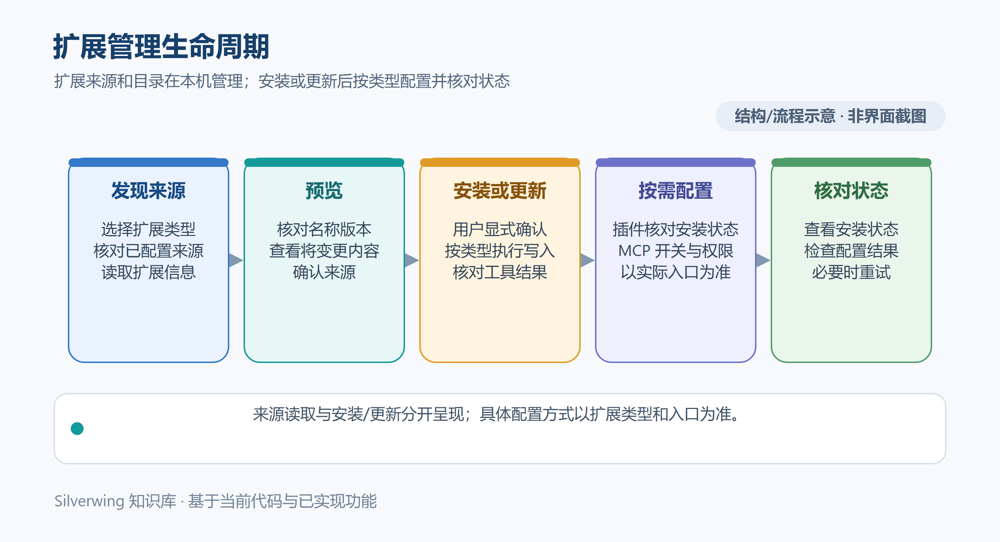

# Codex 插件与 MCP

[返回知识库目录](../Index.md)

> 适用：Silverwing Go / MyGO，源码版本 0.0.1；按 2026-10-19 的代码核对。

Codex 插件和 MCP 管理需要本机 Codex CLI。Silverwing 通过 CLI 浏览 Marketplace、安装或卸载插件；MCP 状态和配置读写通过 CLI 的 `app-server --stdio` 接口完成。Codex 桌面应用仍是独立程序，打开任务目录的方式见 [IDE 与 Agent 配置](13-IDE与Agent配置.md)。

本图是通用扩展管理示意。本文中的 Marketplace 来源和插件安装操作通过 Codex CLI 执行；MCP 使用独立的配置与授权入口，不要求依次完成图中所有步骤。

## 准备 Codex CLI

打开 **设置 → 任务 → 任务创建区**，查看 **Codex CLI 状态**。路径留空时 Silverwing 自动探测；也可在 **Codex CLI 命令路径** 中手动选择程序，再从状态卡更多菜单点 **检查状态**。状态可用后，Codex 插件页面才能查询 Marketplace；MCP 页面还要成功连接 CLI 的 app-server。

任务目录用 Codex 的桌面应用入口打开，并不要求 CLI；反过来，CLI 状态正常也不保证 `codex://` 桌面链接能打开。遇到问题时分别确认 CLI 状态与 Codex 桌面应用安装。

## Marketplace 与插件

1. 进入 **设置 → Codex → Codex 插件**，点 **添加来源**，填写来源名称、Marketplace Git 仓库地址和可选分支或标签。当前界面按仓库根目录读取 Marketplace 清单。
2. 添加来源会把它登记到本机 Codex，并立即尝试读取插件目录。若目录未读取，打开来源更多菜单点 **刷新目录**；这会刷新 Marketplace、更新本机目录缓存并重新列出插件，不只是读取 Silverwing 内部快照。
3. 在插件行点 **预览**，查看名称、说明、README、能力和内置 Skill。预览只读取已缓存清单与文件，不安装或执行插件。
4. 点 **安装** 并确认。若显示外部已安装，可选择 **接管**；接管只让 Silverwing 记录并管理该插件的后续卸载，不代表重新安装。成功后来源卡会显示已安装及管理归属。
5. 对 Silverwing 管理的插件，可从更多菜单执行 **卸载**。移除 Marketplace 来源会清除来源注册与 Silverwing 的该来源记录，但不会自动卸载已经安装的插件。Silverwing 当前不提供插件启用开关。

页面初次 **重新读取** 主要展示已保存的 Marketplace 快照；如果插件目录可能已变化，使用来源上的 **刷新目录** 获取最新信息。来源或插件在本机 Codex 中由其他方式修改后，也应刷新再判断状态。

## 查看和管理 MCP

从 **设置 → Codex → MCP 管理** 可在 **全局配置** 与 **当前任务** 间切换；当前任务范围仅在任务目录可用时显示。也可从任务详情更多操作进入 **Codex 配置**，直接检查该任务上下文。面板会显示配置来源、文件路径、范围、启用状态和最近连接检查结果。

**读取状态** 会通过 Codex app-server 读取有效配置层，不修改配置。它也会读取已安装插件的缓存清单，发现插件声明的 MCP，并把这些项目标为 **插件提供**。这是目录发现与状态展示，不表示 Silverwing 已启动 MCP，也不代表连接成功。点 **检查连接** 会读取 Codex 返回的 MCP 状态与工具数量；它同样不改配置。

新增或编辑 MCP 时，表单支持本地命令或 HTTP/HTTPS 地址、参数、环境变量、请求头和超时。全局配置写入 Codex 用户配置文件；当前任务配置写入该任务的 `.codex/config.toml`。保存、删除或切换 **启用** 会实际修改 Codex 配置；页面提示这些改动在新建或重启 Codex 会话后生效。编辑或移除操作只对普通全局和任务级配置开放。

插件提供的 MCP 属于受管理配置，不能在 Silverwing 中编辑或删除；可用开关会写入插件配置。若 HTTP MCP 支持认证，使用卡片的 **登录 / 授权** 或任务配置面板的 **认证** 入口；OAuth 授权凭据由 Codex 管理，Silverwing 只展示授权状态，不将其作为表单字段回显。为显示和编辑 MCP 配置，Silverwing 仍会读取其中的 `env` 和 `http_headers`；这些值在表单中默认遮蔽，不等于没有读取。不要把真实密钥粘贴进 Markdown 或任务说明。

## 操作边界与排查

- **目录已读取** 表示 Marketplace 列表已成功返回；它不代表所有插件已安装或已启用。
- **预览** 是本地阅读操作；**安装、接管、卸载、刷新 Marketplace、移除来源** 会调用 Codex CLI 并改变其扩展状态。
- **读取状态、检查连接** 不写配置；**添加、编辑、删除 MCP 和启用开关** 会写入 Codex 配置。
- MCP 显示“未生效”或“被更高优先级配置覆盖”时，先查看面板列出的配置文件与层级；任务配置文件被外部程序同时修改时，刷新状态后再重试。
- CLI 不可用时先确认命令路径和版本状态；Marketplace 读取失败时检查 Git 网络和仓库地址；MCP 未就绪时核对命令、参数、服务地址和外部授权状态。

## 源码索引

- 插件来源与安装生命周期：`internal/desktop/settings_codex_ui.go`、`internal/platform/extensions.go`
- MCP 设置界面及任务面板：`internal/desktop/settings_codex_ui.go`、`internal/desktop/codex_ai_mcp.go`
- Codex 配置层读取、插件 MCP 发现与写入：`internal/platform/mcp.go`
- Codex CLI 的 app-server 通信：`internal/platform/codex_rpc.go`、`internal/platform/codex_stdio.go`

相关阅读：[IDE 与 Agent 配置](13-IDE与Agent配置.md)、[Skills 管理](15-Skills管理.md)、[外部 CLI 与 Codex 集成](../技术架构/26-外部CLI与Codex集成.md)、[常见问题与故障排查](../日常使用/08-常见问题与故障排查.md)。
