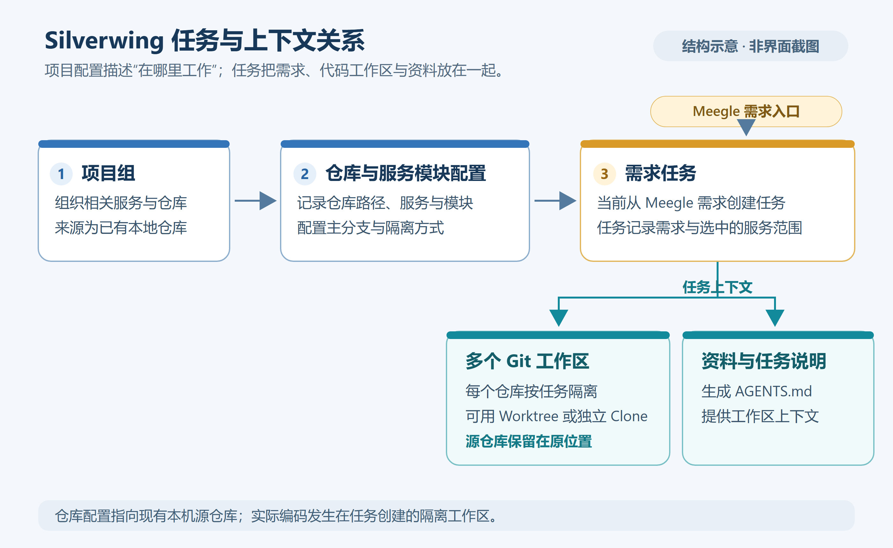
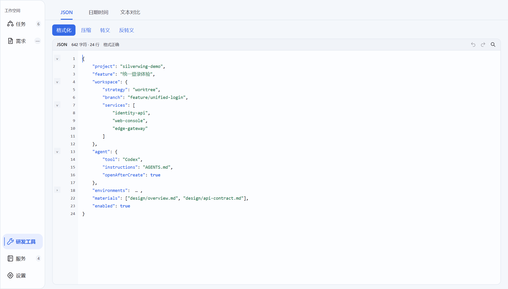

# 产品与核心概念

Silverwing 把一个需求关联的多个代码仓库、隔离工作区、任务资料和开发工具入口组织在一起。它适合一个需求同时修改多个服务、需要在代码与资料之间反复切换的研发场景。

适用当前 **Go / MyGO 版**，源码产品版本 **0.0.1**；代码核对日期：**2026-10-19**。

[返回知识库](../Index.md) · [下一篇：安装与升级](02-安装与升级.md)

## 从一个需求理解 Silverwing

假设需求 `REQ-DEMO-1001` 要实现“订单退款防重”，需要同时修改 `order-service` 和 `payment-service`。

你先把两个已有本地 Git 仓库加入 Silverwing，并放在同一个项目组中；接着从 Meegle 需求创建任务，为选中的服务模块建立工作区。进入任务后，可以查看需求、阅读资料、维护任务说明，在 IDE 或 Codex 中打开对应目录，并审阅两个仓库各自的修改。

这些名字只是贯穿知识库的虚构示例。

*结构示意图：依据当前实现绘制，非界面截图。*

## 六个需要先理解的概念

| 概念 | 表示什么 | 示例 |
| --- | --- | --- |
| 项目组 | 将相关仓库、服务配置及任务组织在一起，也可提供组级说明 | 订单平台 |
| 本地仓库 | 已经存在于电脑上的 Git 仓库，是建立任务工作区的来源 | `D:\dev\repos\order-service` |
| 服务 | 绑定一个本地仓库、包含一个或多个工作区模块的业务配置 | 订单服务 |
| 模块 | 服务下独立的工作区配置，可设置基线、隔离策略和快捷命令 | `default` 模块、另一个分支工作区模块 |
| 任务 | 承载需求关联、分支、服务工作区、资料与生命周期的本地记录 | `REQ-DEMO-1001` 对应的研发任务 |
| 工作区 | 真正用于修改代码的 Git 目录，任务可包含多个工作区 | 订单工作区、支付工作区 |

**任务目录与 Git 仓库不是同一个概念。** 一个任务可以包含多个独立 Git 工作区；每个选中的模块对应独立工作区，即使它们来自同一个服务仓库。当前模块不能直接指定仓库子目录。查看路径、切换分支、审阅差异和清理文件时，要落实到对应工作区。

Worktree 与独立克隆的区别见[任务与工作区管理](../日常使用/06-任务与工作区管理.md)。

## 当前可以完成哪些工作

| 能力 | 典型用法 | 使用条件 |
| --- | --- | --- |
| 仓库与服务管理 | 按项目组登记本地仓库、模块和主分支 | 本机有相应仓库；Git 能正常运行 |
| 任务工作区 | 从需求选择服务，创建 Worktree 或独立克隆工作区 | 配好 Git、仓库与 Meegle 项目 |
| Git 审阅 | 看整体差异、本地未提交修改或提交范围，逐文件左右对比 | 已有可读取的 Git 工作区与基线 |
| 任务资料 | 浏览文件，阅读 Markdown、PDF、图片、表格及图表 | 配好资料位置；媒体资源完整 |
| Agent 上下文 | 组合全局、项目组与任务说明，准备 `AGENTS.md` 等上下文 | 按实际需要配置说明及外部工具 |
| Skills 与 Codex 配置 | 浏览本机 Skill，管理 Git 来源、插件与 MCP 配置 | 对应工具及配置在本机可用 |
| 研发工具 | JSON 处理、日期时间转换、左右文本对比 | 可独立使用；端口工具需要按需开启 |
| 集成工作流 | 读取 Meegle 需求、同步选定资料、查看 Tag 交付和 Genbu 状态 | 分别配置所需 CLI、账号与目标 |

*Windows 实际界面示例，使用示例数据。*

## 先配置什么

### 先体验本地功能

安装后可以直接体验 JSON、日期时间和文本对比；管理仓库时，再配置 Git 与已有本地仓库。IDE、Codex、Cursor 按自己的使用习惯选择，不需要全部安装。

### 从需求开始开发

当前创建任务的入口在“需求”页，需先完成 Meegle 接入。准备好仓库与服务配置后，选中需求，点击“基于需求创建任务”，核对服务范围和分支，再创建工作区。

任务资料 Git 同步与 Genbu 是按需接入的能力，不是体验本地工具的前置条件。

## 开发工具如何参与

Silverwing 负责准备工作区、组织上下文并提供打开工具的入口。IDE、Codex、Cursor 等应用仍需单独安装和配置，实际编程会话在相应外部工具中运行。

项目的 Java、Node、Go 等运行环境，数据库、容器、服务启动和测试依赖，也由项目自身管理。建立了任务工作区后，应继续按该项目的说明启动、测试和验证业务。

## 数据保存在哪里

| 数据 | 默认或配置位置 | 需要记住的区别 |
| --- | --- | --- |
| 应用配置与缓存等 | 用户目录下的 `silverwing`，例如 `%USERPROFILE%\silverwing` | 与程序安装目录分开；`--home` 可指定应用数据目录 |
| 任务及其工作区 | 新初始化时默认使用用户目录下的 `tasks` | 已保存的自定义任务根目录优先 |
| 任务资料 | 按“任务资料根目录”和子目录配置解析 | 可以在独立目录，不保证随任务根一起迁移 |
| 外部工具账号与配置 | 对应 CLI 或应用自己的位置 | 不等于全部保存在 Silverwing 配置备份中 |

因此，升级、迁移电脑或做备份时，应分别确认应用数据、任务工作区和资料目录。

## 接下来怎么读

首次使用按[安装与升级](02-安装与升级.md) → [首次配置](03-首次配置.md) → [Meegle 接入](04-Meegle接入.md) → [第一个多仓库任务](05-第一个多仓库任务.md)阅读即可。

需要了解内部实现时，阅读[技术架构总览](../技术架构/07-技术架构总览.md)；遇到启动、CLI 或工作区问题时，查阅[常见问题与故障排查](../日常使用/08-常见问题与故障排查.md)。

## 源码索引

- `README.md`：功能入口与使用范围。
- `internal/domain/models.go`：产品版本、项目组、服务与任务模型。
- `internal/application/app.go`：应用初始化、默认任务根目录与快照。
- `internal/storage/paths.go`：应用数据目录布局。
- `../../docs/ARCHITECTURE.md`：模块和集成边界。
