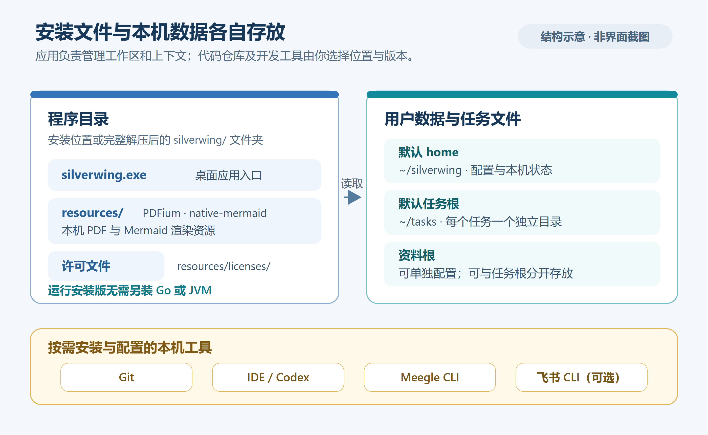

# 安装与升级

本篇说明如何选择 Silverwing 安装包、保留程序所需资源、完成首次启动，以及在升级时保留自己的配置和任务。

适用当前 **Go / MyGO 版**，源码产品版本 **0.0.1**；代码核对日期：**2026-10-19**。安装包是否已上传、可下载哪些版本，以[GitHub Releases](https://github.com/javatoai/silverwing/releases)实际列表为准。

[返回知识库](../Index.md) · [上一篇：产品与核心概念](01-产品与核心概念.md) · [下一篇：首次配置](03-首次配置.md)

## 选择对应平台的安装包

| 平台 | 当前打包脚本支持 | 适合的情况 |
| --- | --- | --- |
| Windows x64 | Setup EXE | 日常安装，提供开始菜单、桌面快捷方式和卸载入口 |
| Windows x64 | MSI | 需要使用 Windows Installer 管理安装 |
| Windows x64 | 免安装 ZIP | 放到自行管理的目录中运行 |
| macOS Apple silicon / arm64 | DMG，内含 `Silverwing.app` | Apple silicon Mac |

当前脚本不提供 Intel Mac、Windows ARM 或 Linux 安装包。不要把源码 ZIP 当作 Windows 免安装包，也不要直接拿其他平台的文件运行。

**运行已打包的程序无需安装 Go、Node、Bun 或 JVM。** Git、IDE 和需要接入的外部 CLI 则按功能需求另外准备。



*目录示意图：依据当前打包与路径实现绘制，非安装界面截图。*

## Windows 安装

### 使用 Setup EXE 或 MSI

1. 关闭正在运行的 Silverwing，选择对应版本的 x64 安装包。
2. 运行安装程序并按提示完成安装。
3. 从“Silverwing Go”快捷方式启动。
4. 打开“设置 → 系统 → 关于”，确认当前启动的是预期版本。

当前 Setup 和 MSI 都是按用户安装，默认程序位置为 `%LOCALAPPDATA%\Programs\Silverwing Go`。Setup 已登记的安装路径会在重装时复用；实际路径以安装选择和系统记录为准。

> [!important] 更换安装包类型
> Setup 与 MSI 不能交叉覆盖安装。若安装程序提示已有另一类型，请先通过原卸载入口卸载，再安装新的类型。保留升级前的数据备份。

### 使用免安装 ZIP

1. 将压缩包**完整解压**到自己的程序目录，例如 `D:\Apps\Silverwing`。
2. 找到其中同时包含 `silverwing.exe` 和 `resources` 的目录。
3. 运行该目录中的 `silverwing.exe`，不要只把 EXE 单独拖到桌面。

解压后的关键结构如下，压缩包外层目录名可以不同：

```text
silverwing/
├── silverwing.exe
├── LICENSE
└── resources/
    ├── native/
    │   └── pdfium.dll
    ├── native-mermaid/
    │   └── windows-x64/
    │       └── mmdr.exe
    └── licenses/
```

`pdfium.dll` 用于 PDF，`mmdr.exe` 用于 Mermaid 图表。若这两个功能异常，先检查完整解压情况，而不是安装 JVM。

在程序所在目录中，可用以下 PowerShell 命令做只读检查：

```powershell
Test-Path -LiteralPath '.\silverwing.exe'
Test-Path -LiteralPath '.\resources\native\pdfium.dll'
Test-Path -LiteralPath '.\resources\native-mermaid\windows-x64\mmdr.exe'
```

完整的 Windows 程序目录应对这三项返回 `True`。

## macOS 安装

1. 选择 Apple silicon / arm64 的 DMG。
2. 打开 DMG，将 `Silverwing.app` 复制到“应用程序”等自己管理的位置。
3. 打开复制后的应用，并在“设置 → 系统 → 关于”核对版本。

当前应用采用 ad-hoc 签名，尚未经过 Developer ID 签名或 Apple 公证。下载的应用可能被系统首次启动保护拦截；核实来源后，按系统“隐私与安全性”中的提示允许打开。

原生资源位于应用包内的 `Contents/Resources/`。移动应用时保留整个 `.app`，不要单独复制 `Contents/MacOS/silverwing`。

## 首次启动检查

| 检查项 | 成功标志 |
| --- | --- |
| 程序启动 | 能看到任务、需求、服务、研发工具与设置等导航 |
| 版本 | “设置 → 系统 → 关于”显示预期产品版本 |
| 本地工具 | JSON、日期时间或文本对比能处理一份示例输入 |
| 数据目录 | 应用数据目录可读写；任务根目录可在设置中查看和调整 |
| 媒体资源 | 有相应示例文件时，PDF 和 Mermaid 可以正常显示 |

初始没有任务、没有接入 Meegle，并不影响先体验本地工具。接下来按[首次配置](03-首次配置.md)准备实际开发环境。

## 升级前保留哪些数据

先在“设置 → 存储 → 配置与备份”导出配置，随后确认以下位置：

- **应用数据目录**：默认 `%USERPROFILE%\silverwing` 或 `~/silverwing`；使用 `--home` 启动时，以该参数为准。
- **任务根目录**：新初始化默认是 `%USERPROFILE%\tasks` 或 `~/tasks`；自定义路径以设置为准。
- **任务资料目录**：在独立资料根下的文件也应单独保留。
- **尚未提交的代码和本地分支**：在相应 Git 工作区中核对状态。

配置导出不是所有代码、任务资料和外部工具账号的完整备份。涉及重要未提交内容时，应先另行保留这些目录中的文件。

## 执行升级

1. 记录旧版本及实际数据目录，完成需要的备份。
2. 关闭 Silverwing 与旧版本的安装程序。
3. Setup / MSI 使用相同类型更新；免安装版解压到新目录并保留完整资源；macOS 替换完整应用。
4. 从新位置启动，核对“关于”中的版本。
5. 确认项目组、仓库、任务列表和资料路径仍正确，再打开一个已有任务验证。

当前“设置 → 系统 → 更新”提供“打开更新页面”和“复制链接”。升级通过发布页面获取安装包完成，不应把打开更新页理解为已经自动下载或安装。

若新版本提示配置不兼容，先保留现有目录，按[故障排查中的配置恢复方法](../日常使用/08-常见问题与故障排查.md)处理；不要直接修改 schema 或整目录清空配置。

## 没有合适安装包时从源码构建

源码构建需要 `go.mod` 声明的 Go **1.27.1** 工具链。以下命令都在 Silverwing 源码根目录执行。

Windows 免安装包：

```powershell
.\scripts\build-windows.ps1 -PortableOnly
```

输出位于 `build/native-release/windows-amd64/<版本>-<UTC构建时间>/`。构建脚本会准备校验固定版本的媒体资源和依赖许可证；构建时需要相应下载可用。

Apple silicon Mac 的 DMG：

```bash
bash ./scripts/build-macos.sh
```

macOS 构建还需要 Xcode 命令行工具及系统签名、DMG 工具，输出位于 `build/native-release/macos-arm64/` 下的新目录。Windows Setup / MSI 的完整打包额外需要 NSIS **3.13** 和 WiX **3.14.1**；详细参数见源码的 `../../docs/RELEASE.md`。

## 源码索引

- `scripts/windows-installer.nsi`、`scripts/windows-installer.wxs`：安装位置、快捷方式及包类型互斥。
- `scripts/build-windows.ps1`、`scripts/build-macos.sh`：构建条件、资源和产物目录。
- `internal/desktop/settings_environment_ui.go`：关于与更新入口。
- `cmd/silverwing/main.go`、`internal/application/app.go`：应用 Home 与默认任务根目录。
- `../../docs/RELEASE.md`、`../../docs/NATIVE-MEDIA.md`：打包和原生资源说明。
