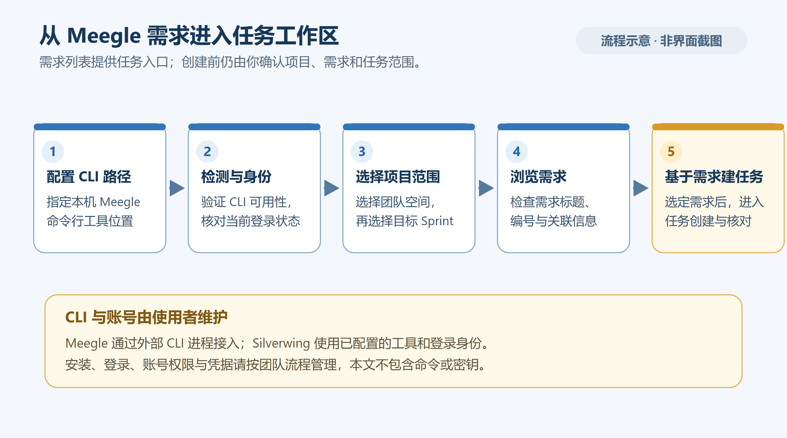

# Meegle 接入

本文适用于 Silverwing 0.0.1（当前 Go/MyGO 版），内容已按当前代码核对，核对日期为 2026-10-19。这里说明如何配置本机 Meegle CLI、确认当前登录账号、选择项目空间，并从需求创建 Silverwing 任务。

[返回知识库首页](../Index.md) · [上一篇：首次配置](03-首次配置.md) · [下一篇：第一个多仓库任务](05-第一个多仓库任务.md)

> [!important] 使用团队提供的 Meegle CLI
> 当前代码没有给出通用 CLI 安装或登录命令。请使用团队发行版；安装或获取方式按团队指引处理，再回到 Silverwing 检测 CLI。本文只介绍 Silverwing 界面中已实现的操作，不要照抄其他环境的命令。

## 1. 检查 CLI 路径和状态

打开左侧「设置」→「CLI」→「Meegle CLI」。先看「命令状态」和版本：路径留空时会尝试自动检测，并在成功检测后保存；若未检测到，在「Meegle CLI 可执行文件」选择团队发行版中的可执行文件。修改后自动保存，再从页面右上角菜单点「刷新状态」。成功时应显示命令可用、版本和登录状态。

如果状态仍提示未安装或无法启动，先确认发行版完整、路径指向实际可执行文件，再刷新。也可以从路径区域使用「复制命令路径」或「在终端中运行」辅助诊断；Silverwing不会在这里替你安装 CLI。

## 2. 登录并核对当前账号

若页面显示「尚未登录」，点击「登录 Meegle CLI」。Silverwing会启动设备码授权流程并打开浏览器；页面会显示设备码状态、授权页和验证码，也可点「复制授权链接」或「复制验证码」。在浏览器完成团队账号授权，返回应用等待状态更新为「已登录」。若授权过期或失败，重新开始登录并确认浏览器使用的是预期账号。

Silverwing没有单独的 profile 下拉框；它沿用本机 Meegle CLI 当前启用的 profile。需求读取会核对 profile、登录状态、当前用户和租户身份，并按身份隔离需求缓存。设置页显示 CLI 登录状态和 host，不一定展示具体人员账号。若你刚在 CLI 外部切换了 profile 或账号，请回到本页「刷新状态」，再重新打开项目空间选择器或刷新需求列表；账号配置变化时，旧的项目目录和需求结果可能会失效。

需要退出时，可从 Meegle CLI 页面右上角菜单选择「退出登录」并确认。退出会改变本机 CLI 登录状态；已保存的项目空间配置仍保留。

## 3. 添加可用项目空间

在「Meegle 项目空间」卡片点「添加项目空间」。选择器会读取当前已登录账号可访问的项目目录；用项目名称、短名或 Key 搜索，点选正确项目即可添加。需要重新读取时点搜索框旁的「刷新项目目录」。选择器要求 CLI 可用且已登录；项目目录读取失败会显示错误，先检查登录状态和账号，再刷新。

选中后，Silverwing会保存项目的 `project_key` 和 `simple_name`。已添加的空间不会重复列在可添加选项里。卡片中已有项目行也支持编辑 Key 和短名，修改会自动保存；首次接入建议用选择器，避免手工填错 Key。添加完成后，确认项目出现在卡片列表中。

「默认 Sprint 团队空间」是选配项。选择一个已添加的空间，可以帮助需求页确定初始选择；选「未指定」则不设置默认空间。通常只检测到一个进行中 Sprint 时会自动选中它；存在多个进行中 Sprint 时，需求页可能初始选中默认空间返回的首个进行中 Sprint，仍需核对页面显示的名称。若没有自动选中，在需求页手动选择。

## 4. 刷新需求并创建任务

进入左侧「需求」页面。至少添加一个 Meegle 项目空间并保持 CLI 已登录；页面会读取可选的进行中或未开始 Sprint。若显示「选择 Sprint」，从列表选择要查看的团队空间和 Sprint。列表只收录当前账号参与的工作项，支持需求、技术改进、缺陷和任务类型；你没有参与的条目不会出现在列表中。

点列表顶部刷新图标（提示为「刷新当前 Sprint」）可重新读取当前 Sprint。遇到部分查询失败时，页面会列出未完成项，可点「重试需求查询」；不要把部分结果当成完整清单。没有配置空间时，页面提供「前往 Meegle CLI 设置」入口；没有可选 Sprint 时，先检查项目空间是否正确以及账号是否能访问对应项目。

选中需求后，点击「基于需求创建任务」。这会打开预填需求标题和链接的任务表单，不会立即创建任务。继续选择项目组、启用的服务和模块，核对分支及工作区选项，然后点「检查并创建任务」查看预检，再确认创建。创建前需要已配置可写的「任务根目录」，并至少有一个含可用服务和模块的项目组；这些本地工作区设置见[首次配置](03-首次配置.md)。

## 常见问题

- **项目选择器没有项目**：确认 CLI 状态显示可用和已登录，再确认当前 profile/账号具有项目访问权限；点「刷新项目目录」。若账号刚切换，重新检查状态后再打开选择器。
- **需求页没有条目**：先选一个 Sprint；列表按当前账号参与关系筛选，且只读取进行中或未开始的 Sprint。检查项目空间、当前账号和 Sprint 后点「刷新当前 Sprint」。
- **刷新后提示账户变化**：CLI profile、登录账号、CLI 路径或本机配置可能已变化。重新检查 Meegle CLI 状态，确认当前授权账号，再刷新项目目录和需求列表。
- **需求创建表单无法继续**：回到「服务」确认任务所属项目组、启用服务和工作区模块均已配置，且任务根目录可写；修正后重新打开表单并预检。

## 相关阅读

- [首次配置](03-首次配置.md)
- [第一个多仓库任务](05-第一个多仓库任务.md)
- [常见问题与故障排查](../日常使用/08-常见问题与故障排查.md)

代码依据：`internal/desktop/settings_cli_ui.go`、`internal/desktop/settings_meegle_projects.go`、`internal/desktop/settings_meegle_project_picker.go`、`internal/desktop/settings_source_parity.go`、`internal/platform/cli_auth.go`、`internal/integrations/meegle.go`、`internal/integrations/requirement_cache.go`、`internal/desktop/requirement_page.go`、`internal/desktop/task_creation_ui.go`。
