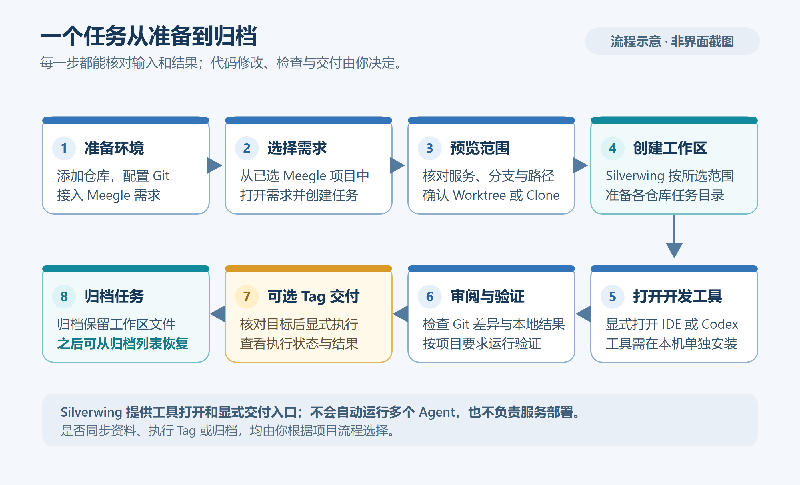

# 第一个多仓库任务

[返回目录](../Index.md) · [上一篇：Meegle 接入](04-Meegle接入.md) · [下一篇：任务与工作区管理](../日常使用/06-任务与工作区管理.md)

本文以 Go / MyGO 版 Silverwing 当前实现为准，核对日期：2026-10-19。流程图根据当前实现绘制，属于示意图，不是界面截图。



> **虚构示例**：`REQ-DEMO-1001`、`order-service`、`payment-service`、任务名称和分支均为演示数据。请在实际操作中选择你已接入的 Meegle 需求和仓库配置；不要把示例编号或链接当作真实需求使用。

## 开始前

完成[首次配置](03-首次配置.md)和[Meegle 接入](04-Meegle接入.md)，并确认本例的项目组已关联至少两个可用服务。每个服务应有有效仓库路径、主分支和模块；开发工具是选配项，仅在希望从 Silverwing 打开工作区或创建后自动打开时，才需要安装并配置相应工具。

本例假设项目组中有 `order-service` 与 `payment-service` 两个服务，每个服务各选一个模块。任务名示例为“订单退款防重”，任务分支示例为 `feature/REQ-DEMO-1001_order-refund-guard`。这是示例输入，不代表 Silverwing 会自动创建同名服务或仓库。

## 创建任务

### 1. 从需求进入

打开 **需求** 页面，找到目标需求；在需求详情中选择 **基于需求创建任务**。也可以在创建表单的需求栏粘贴实际需求链接，或搜索并选择 Meegle 候选项。当前任务入口依赖需求列表或需求链接，不提供脱离需求的手工离线建任务入口。若需求候选加载失败，先检查 Meegle 设置，或按表单提示填写完整的实际需求链接。

**完成标志**：创建表单已带入需求标题或链接，且需求栏不再停留在未选择的搜索文本。

### 2. 设置名称、分支和服务模块

在表单填写任务名称与任务分支，选择项目组，再勾选 `order-service` 和 `payment-service`。展开每个服务，核对模块、基础分支和目标分支。通常每个服务可以只选一个模块；如选择多个模块，逐个检查它们各自的分支和工作区策略。

每个模块可选 **Worktree** 或 **独立克隆**：

- **Worktree** 从配置的本地仓库准备独立工作目录，目标分支必填。若本地或远程分支已存在，预检会列出复用情况；若分支已被其他 Worktree 检出，需理解共享影响并明确确认。锁定中的 Worktree 不能被自动复用。
- **独立克隆** 从该仓库配置的远程地址创建单独的 Git 克隆，目标分支可以留空；留空时以模块基础分支为当前分支。它与原本地仓库相互独立，独有的本地提交不会因共用对象库而保存在原仓库中。

两个服务可以采用同一示例分支名，因为它们属于不同仓库；如果服务共享同一仓库，则应为同时使用的 Worktree 模块设置不同目标分支。填写前确认远程和基础分支正确，避免从错误基线创建工作区。

**完成标志**：服务与模块均通过表单校验；每个 Worktree 模块都有目标分支；右侧任务说明预览和需求资料预览没有未处理的错误提示。

### 3. 检查预览并创建

表单右侧可在 **任务说明预览** 与 **编辑任务说明** 间切换。预览用于核对将写入任务的 Agent 说明；“创建后打开工作区工具”可勾选当前可用的 IDE 等工具。点击 **检查并创建任务** 后，Silverwing 会执行任务信息和分支预检，并准备任务资料目录状态。

若分支已存在，检查窗口会显示冲突模块和分支。先核对分支、仓库及已检出的 Worktree，再选择返回修改或确认复用并创建。确认共享已检出分支前，要确保并行修改是预期行为。预检期间可查看进度；不要重复提交或在状态仍显示处理中时关闭窗口。

**完成标志**：预检结束后任务创建进度完成，任务出现在研发任务列表；任务详情中每个服务模块都有独立工作区卡片。失败时先阅读具体模块提示，不要把不完整的任务当作已准备好。

## 检查任务文件与资料

新任务目录位于设置的任务根目录之下，通常形如：

```text
<任务根目录>/订单退款防重/
├─ silverwing.json
├─ AGENTS.md
├─ .workspace/
│  ├─ agent/
│  │  ├─ TASK-CONTEXT.md
│  │  └─ TASK-RULES.md
│  └─ HANDOFF.md                 # 仅有 Agent CLI 交接上下文时出现
├─ order-service-<模块名>/       # 一个 Git Worktree 或独立克隆
└─ payment-service-<模块名>/     # 一个 Git Worktree 或独立克隆
```

实际文件夹名由任务名称及服务、模块配置生成；以任务详情卡片显示的工作区路径为准。`silverwing.json` 保存需求、分支、服务模块、工作区策略和生命周期等任务元数据。根目录 `AGENTS.md` 是 Agent 规则路由；`.workspace/agent/TASK-CONTEXT.md` 描述任务上下文与允许修改的 Worktree，`TASK-RULES.md` 保存本任务说明。若使用 Agent CLI 交接，上下文还会带有 `.workspace/HANDOFF.md`。

点击 **任务资料** 页签查看需求资料。资料目录依赖设置中的资料根目录和子目录；未配置时会显示未关联状态。若创建后资料准备失败，任务仍可能创建成功，可从任务更多操作中选择 **关联任务资料** 或 **重试关联任务资料**。资料预览或“准备需求资料”步骤的提示不等同于需求正文已经完整下载，创建后应检查目录状态和实际文件。


> 配图来自 Windows 示例数据，仅用于识别资料面板和浏览方式；需求名称、文件及路径不代表你的实际任务。

## 打开工具并审阅改动

在对应工作区卡片点击 **使用〈开发工具〉打开**，会按该服务配置的工具打开这个工作区；也可从任务更多操作选择 **在 Codex 中打开**，让 Codex 以任务目录为上下文。首次交给 Agent 前，先读任务根目录 `AGENTS.md` 和其中引用的上下文、任务规则；按 `TASK-CONTEXT.md` 中列明的 Worktree 范围工作。

开发后回到工作区卡片，等待 Git 状态刷新。点击 **本地未提交 N** 可查看暂存、未暂存和未跟踪文件，数量为 0 时仍可进入；**提交历史** 用于核对新增提交，旁边的远程状态只展示信息。进入审阅页后，可切换 **整体差异** 查看当前分支相对主分支的已提交差异，也可从更多菜单开启“包含本地未提交”。逐个检查服务工作区，确认修改只落在预期仓库、分支和文件范围内。比较范围说明见[Git 差异审阅](../日常使用/10-Git差异审阅.md)。


> 配图来自 Windows 示例数据，用于展示 Git 改动审阅入口；实际仓库、分支与文件会不同。

**完成标志**：两个服务卡片都显示预期分支；本地未提交文件和整体差异已逐项审阅；任何提交或推送由你按团队流程决定，任务创建本身不会替你完成代码审阅。

## 可选：构建测试 Tag

只有在全局 Tag 功能开启、模块已配置 Tag 且工作区状态可用时，任务详情才会显示 **批量构建 Tag**。打开后勾选要构建的服务模块，核对目标方式和分支，再点击 **开始构建**；执行记录可在 **Tag** 页签查看。不同模块可能采用不同的 Tag 模式和目标分支，执行前以界面展示为准。

## 完成后归档

确认后续不再活跃处理时，在研发任务列表的任务行上打开右键菜单，选择 **归档任务** 并确认。任务会转入归档列表，当前实现会保留任务目录、工作区和代码。需要继续时，在归档列表对该任务选择 **恢复归档**；恢复会让它回到研发任务列表，不会自动打开该任务。

## 下一步

继续阅读[任务与工作区管理](../日常使用/06-任务与工作区管理.md)，了解任务导航、Worktree 与克隆差异，以及归档、恢复和永久删除的具体影响。

[上一篇：Meegle 接入](04-Meegle接入.md) · [下一篇：任务与工作区管理](../日常使用/06-任务与工作区管理.md) · [知识库目录](../Index.md)

## 源码索引

- 创建入口与预检：`internal/desktop/requirement_page.go`、`internal/desktop/task_creation_ui.go`、`internal/desktop/task_creation_confirmation_ui.go`
- 任务目录、工作区与 Agent 文件：`internal/workspace/task_application.go`、`internal/workspace/provisioner.go`、`internal/workspace/agent_documents.go`
- 工作区状态与差异：`internal/desktop/workspace_card_ui.go`、`internal/desktop/workspace_history_ui.go`
