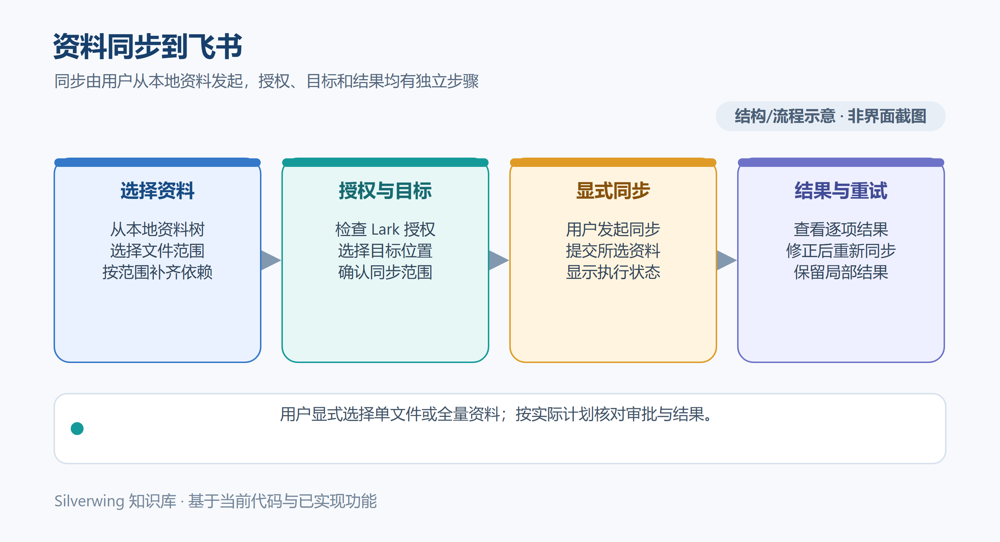

# 飞书资料同步

[返回目录](../Index.md)

> 适用产品版本：Silverwing Go 0.0.1　｜　代码核对日期：2026-10-19

资料同步是用户显式发起的单向操作：将当前任务资料目录中的选定文件或整批资料写入已配置的飞书知识库节点。它不是后台自动同步，也不是把飞书内容下载/导出到本机。

> 示意图按当前实现绘制，不是界面截图。

## 配置与授权

开始前在 **设置 → 存储 → 目录** 配置任务资料根目录及资料子目录，并在 **飞书同步目标** 中选择或填写目标知识库节点 URL。核对目标节点确实属于预期空间和目录，避免把资料写入错误知识库。

同步使用本机配置的 Lark CLI 授权。在 **设置 → CLI → Lark CLI** 检查可执行文件、版本和登录状态；按授权页面选择业务域权限。当前同步链路访问 `wiki`、`docs`、`drive`，因此需具备相应读取/写入权限。Silverwing 不会代替用户完成授权，也不会自动发现或选择另一个飞书目标。同步读取磁盘文件：外部编辑器中的 Markdown 需先保存；在 Silverwing 编辑的普通文本需先完成自动保存或处理冲突。

整目录同步完成后若还要发布需求评论，另外需要 Meegle CLI 已登录，且关联需求的项目和工作项校验通过。Lark 资料上传与 Meegle 需求评论是两个阶段，上传成功不代表评论也已成功。

## 选择同步范围

- **同步单个文件：**在资料树对文件打开上下文菜单，选择 **同步此文件及父级到飞书**。该入口不能选择目录；普通文件只上传选中的文件及其父目录结构。选中图片或附件时，会作为普通文件上传。
- **同步全部资料：**在资料目录工具栏/目录菜单选择 **同步到飞书** 或 **同步全部资料到飞书**，按完整资料根目录生成同步计划。此模式可能包含新增、更新、删除和冲突项目，开始前需要认真审阅计划。
- **打开飞书在线文档：**这是单独的打开操作，不会下载文件，也不等同于同步。

选中 Markdown 时，单文件同步还会检查其引用的图片/附件依赖，并补入祖先目录中的 `Index.md`；不会把未选中的相邻 Markdown 文档一并上传。已登记映射的本地资料链接会改写成对应飞书链接。显式选中文档若引用未同步、未登记的 Markdown，链接检查会失败，需先补齐目标文档；自动补入的父级 `Index.md` 对未映射的同级 Markdown 保留文本引用。需求评论不是单文件同步的一部分。

## 预览、确认与结果

整目录扫描会生成 `CREATE`、`UPDATE`、`DELETE`、`SKIP`、`CONFLICT` 等计划项。新增和更新会创建或更新目标知识库节点；只有本地文件已消失、且本地清单仍能对应到远端节点时，完整范围扫描才可能提出删除。远端文件内容/评论发生变化，或节点被手动重命名、移动时，可能形成冲突。删除和可覆盖冲突需要人工勾选确认，冲突默认不覆盖；计划中其他文件继续保留。

若没有删除或冲突等需人工决策的项，流程可以直接继续；否则检查每项路径、动作和目标后确认。确认之后系统会重新扫描并校验本地文件指纹与远端计划；期间文件或远端状态变化时，会停止并要求重新预览，避免按过期计划覆盖内容。

例：资料目录中有 `materials/REQ-DEMO-1001/acceptance.md`，其中引用 `images/flow.png`。先核对目标 wiki 目录，再从 Markdown 文件菜单发起同步；系统按该文件、被引用图片及必要的父级 `Index.md` 生成计划，不包含同目录未选中的其他说明文档。出现审批项时逐项确认，否则流程直接推进。结束时核对新增/更新/跳过/冲突/失败数量，并打开目标节点确认文件链接可访问。

同步进度区会显示新增、更新、删除、跳过、冲突及失败项目。限流等可恢复错误可能自动等待并重试，界面会显示重试次数；其他部分失败不会自动把整批操作伪装为成功。当前没有“对失败文件点一下原计划重试”的按钮；重新同步会重新生成计划，应先查看上次结果、处理冲突，再检查新计划。若整目录同步完整成功且关联需求允许评论，系统会通过 Meegle CLI 单独发布或更新需求评论；单文件同步不发评论。若上传成功但评论失败，核对 Meegle 登录和需求目标后使用“仅重试评论”，不需要重新上传文件。

同一时刻全局只允许一个任务资料飞书同步作业。可以隐藏进度窗口而让任务继续运行，之后用 **查看同步/结果** 返回；停止会取消作业并等待清理。切换任务后，若任务路径、创建时间、资料根目录或需求身份等不再匹配，旧作业迟到的回调会被丢弃，不应用到当前任务。确认结果时回到原任务查看同步记录。

## 源码索引

- 同步入口、文件菜单、进度和取消：`internal/desktop/materials_feishu_sync_ui.go`、`internal/desktop/materials_feishu_sync_jobs.go`
- 单文件依赖范围、目录计划与冲突判断：`internal/domain/materials.go`、`internal/integrations/materials.go`
- 飞书节点、文件与评论调用：`internal/integrations/feishu_gateway.go`
- Meegle 需求评论及身份核验：`internal/integrations/requirements.go`
- 同步动作编排和配置入口：`internal/application/materials_sync_actions.go`、`internal/desktop/settings_core_ui.go`、`internal/desktop/settings_cli_ui.go`
- 本机外部 CLI 配置：`internal/platform/cli.go`

## 相关文档

[首次配置](../入门与基础/03-首次配置.md) · [任务资料使用](../日常使用/11-任务资料使用.md) · [Meegle 接入](../入门与基础/04-Meegle接入.md) · [配置项参考](../配置与数据/19-配置项参考.md)
