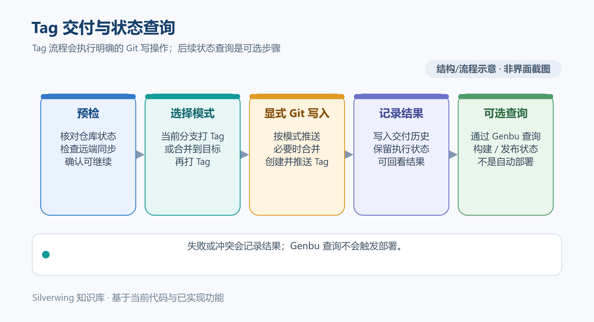

# Genbu 与 Dragon 平台连接

[返回目录](../Index.md)

Silverwing 内置 Genbu 与 Dragon 连接。Genbu 用于查询 Tag 构建、发布及服务状态。Dragon 用于提交青龙提测审批。两项连接共用账号，各自管理启用状态和登录。

> 示意图按当前实现绘制，不是界面截图。

## 保存账号并测试连接

1. 打开 **设置 → 工具与连接 → 平台连接**，填写共用账号和密码，点 **保存账号**。编辑同一个账号时，密码留空可保留已保存的密码。
2. 按需启用 Genbu 或 Dragon，分别点击对应的 **测试登录**。测试成功表示账号能登录该平台。服务查询和审批提交仍需该平台授予对应权限。
3. 使用 Tag 状态查询时，在服务配置中启用 **Genbu 探测**，填写平台上的准确服务名。使用青龙提测时，在任务的「任务分支」页打开 **青龙提测**，核对需求和服务后提交。

## 查看状态

选择任务并打开 **Tag** 页。只有 Tag 操作状态为成功或已推送且记录中存在有效 Tag，同时服务启用了 Genbu 探测时，Silverwing 才会查询状态。Silverwing 通过 Genbu 接口读取状态并更新历史记录。

Tag 页打开时会自动轮询：新记录、未知状态或构建进行中通常每 5 秒查询；其他空闲记录通常每 30 秒查询。离开 Tag 页会停止自动轮询。UAT 成功、构建失败或有更新的发布记录取代当前记录后，也会停止相应轮询。页面菜单中的 **刷新** 可手动强制重新读取。

例：虚构服务 `billing-api` 对应 Genbu 名称 `billing-service`，Tag 历史记录显示 `2.4.1`。先确认服务配置已启用探测且名称与 Genbu 项目一致，再打开任务的 Tag 页；当远端状态变化时，检查同一条记录下分开的 **构建** 和 **UAT** 徽标。若显示未找到或查询失败，先核对 Genbu 登录结果、服务映射和该 Tag 的远端记录，再点 **刷新**；不要重复创建 Tag 来“触发构建”。

## 状态含义与边界

- **Tag 操作成功：**Git 写入完成，Tag 已创建并推送。历史列表中本地操作状态的“构建成功”文案容易误读；它并非 Genbu 构建结果。
- **Genbu 构建成功：**Genbu 查询结果中的 Build 状态为成功，只说明构建阶段完成；它不能证明 UAT 已发布。
- **Genbu UAT 成功：**UAT 徽标显示成功，才代表查询到 UAT 发布成功状态。仍应以目标服务/环境和记录时间核验是否对应预期发布。

Tag 历史会显示 **构建** 和 **UAT** 两类状态。出现构建失败时，可检查对应记录的构建日志。

**核验顺序：**先确认 Tag 历史中的仓库、服务、模块和 Tag；再分别读取本地 Git 操作状态、Genbu 构建状态、Genbu UAT 状态。若三者不一致，以各自状态字段及对应系统中的记录为准，不用“Tag 成功”替代构建或 UAT 的证据。

## 源码索引

- 平台连接和账号设置见 `internal/application/platform_connections.go`、`internal/desktop/settings_platform_connections.go`。
- Tag 记录与 Genbu 查询：`internal/delivery/tag.go`、`internal/delivery/tag_probe.go`、`internal/application/delivery_actions.go`
- 轮询调度和历史状态展示：`internal/desktop/tag_genbu_poll_schedule.go`、`internal/desktop/tag_history_ui.go`、`internal/desktop/tag_status_ui.go`

## 相关文档

[Tag 交付](../日常使用/12-Tag交付.md) · [网络代理与 CLI 环境](../配置与数据/22-网络代理与CLI环境.md) · [外部 CLI 与 Codex 集成](../技术架构/26-外部CLI与Codex集成.md)
