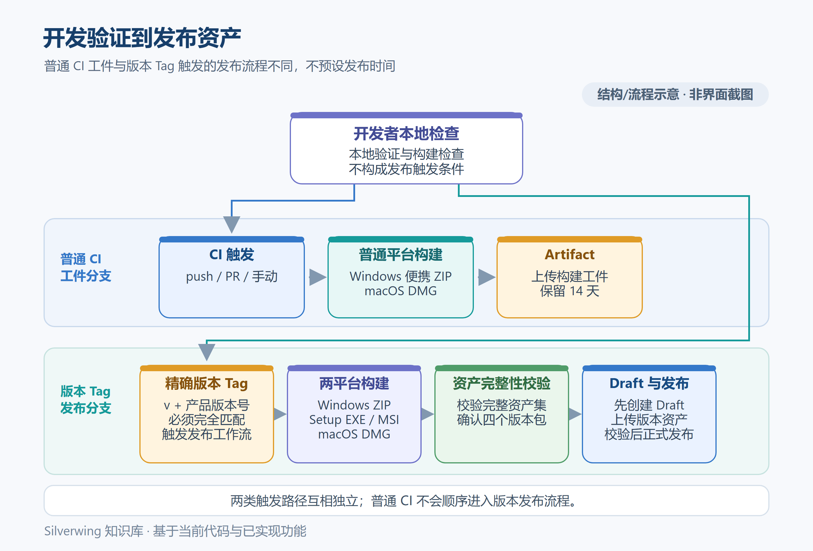

# 28 本地开发与调试

> 适用产品版本：Silverwing Go 0.0.1　｜　代码核对日期：2026-10-19
>
> 配图为开发与发布流程示意图，不是产品界面截图。

[返回目录](../Index.md) · [上一篇：原生渲染与 MyGO 补丁](../技术架构/27-原生渲染与MyGO补丁.md) · [下一篇：测试与贡献指南](29-测试与贡献指南.md)



## 开发前先隔离数据

仓库要求 Go 1.27.1，入口在 `cmd/silverwing`，MyGO 使用 `go.mod` 固定的 v0.5.0 本地补丁模块。先在仓库根目录确认 Go 工具链可用，再用独立分支或工作区修改代码；不要在拿不准归属时覆盖已有改动。

Silverwing 的应用数据目录、任务根目录和任务资料根目录是三个独立位置。`--home` 只指定应用数据目录，默认值是当前操作系统用户目录下的 `silverwing`。更容易忽略的是，`application.New` 会把默认任务根目录设为当前用户目录下的 `tasks`；首次读取配置时会创建或扫描这个目录。因此，单独传 `--home` 并不能隔离本机任务。

最稳妥的手工调试方式是在专用测试账号或虚拟机中运行，并为外部 CLI 使用单独测试配置。进入设置页后，打开「设置」→「存储」→「目录」，把「任务根目录」指向仓库下的 `build/dev-tasks`，把资料根目录和资料子目录分别指向 `build/dev-materials` 和 `dev`；先确认界面显示的路径，再创建虚构任务。`build/` 是本地构建与测试输出位置，避免把测试任务混入真实任务根。即使应用 Home 放在 `build/dev-home`，也要单独核对上述两个根路径。临时覆盖 `HOME` 或 `USERPROFILE` 只应作用于单个子进程或专用测试账号；它会改变 Go 和被启动 CLI 寻找用户目录的位置，不要改成当前终端会话的全局设置。

## 启动与检查界面

在 Windows PowerShell、仓库根目录和隔离测试账号下，可用 `go run` 启动应用并打开设置页：

```powershell
$devHome = Join-Path (Get-Location).Path 'build\dev-home'
go run ./cmd/silverwing --home $devHome --page settings
```

`--page` 可选择 `tasks`、`archive`、`requirements`、`services`、`repositories`、`tools`、`skills` 或 `settings`。`--dark` 设置深色主题；`--width`、`--height` 覆盖窗口初始尺寸；`--tab` 选择任务详情、任务资料、需求详情、需求说明或 Tag 标签页。指定页面或标签会关闭上次会话恢复，便于稳定复现某个入口。更改后的窗口行为仍要在目标操作系统上人工确认。

截图适合记录界面状态，不等于测试通过。例如从仓库根目录生成设置页 PNG：

```powershell
New-Item -ItemType Directory -Force -Path build | Out-Null
go run ./cmd/silverwing --home $devHome --page settings --dark --width 1600 --height 1000 --capture (Join-Path (Get-Location).Path 'build\dev-settings.png') --capture-only
```

`--capture` 指定原生窗口 PNG 路径；需要截图后退出时，再同时传入 `--capture-only`，并确保目标目录存在。若需要检查控件交互、键盘输入、窗口尺寸变化或系统剪贴板，仍需实际操作窗口，单张截图无法覆盖这些行为。

## 原生资源与调试范围

`go run` 负责编译并启动 Go 程序，不会代替发行脚本准备所有随包资源。常规页面可用于开发迭代；验证 PDF 预览和 Mermaid 图时还要准备与当前系统、架构匹配的原生资源，并按程序实际查找位置放置。Windows portable 目录使用 `resources/native/pdfium.dll` 与 `resources/native-mermaid/windows-x64/mmdr.exe`；macOS 应用包使用 `Contents/Resources/native/libpdfium.dylib` 与 `Contents/Resources/native-mermaid/macos-arm64/mmdr`。缺少资源时，媒体功能可能不可用，不能据此判断页面代码本身正常或异常。

资源版本、SHA-256、路径和本地准备方式以 `../../docs/RELEASE.md`、`../../docs/NATIVE-MEDIA.md` 及[构建打包与发布](30-构建打包与发布.md)为准。需要重现发行布局时走对应平台的构建脚本；普通业务逻辑调试不必先制作安装包。开发步骤按「隔离数据 → 运行目标页面 → 验证交互或日志 → 记录结果」推进；若问题涉及路径、外部进程或原生媒体，应同时记录操作系统、架构、所用根目录和缺失的资源名称。

## 源码入口

- 启动参数与页面选择：`cmd/silverwing/main.go`
- Home、任务目录和默认根路径：`internal/storage/paths.go`、`internal/application/app.go`、`internal/storage/config_store.go`
- MyGO 资源路径：`internal/desktop/main.go`、`internal/buildinfo/buildinfo.go`
- Mermaid 与 PDFium 查找：`internal/desktop/markdown_ui.go`、`internal/media/library.go`

[测试与贡献指南](29-测试与贡献指南.md) · [构建打包与发布](30-构建打包与发布.md) · [返回知识库目录](../Index.md)
