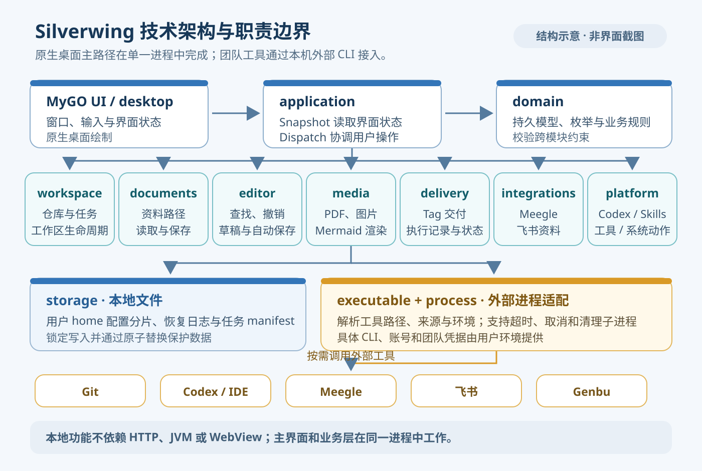

# 技术架构总览

> 适用产品版本：Silverwing Go 0.0.1　｜　代码核对日期：2026-10-19
>
> 配图为代码架构示意图，不是产品界面截图。

[返回目录](../Index.md) · [上一篇：任务与工作区管理](../日常使用/06-任务与工作区管理.md) · [下一篇：常见问题与故障排查](../日常使用/08-常见问题与故障排查.md)

## 整体结构

Silverwing 是 Go 与 MyGO 构建的原生桌面工作台。界面与应用逻辑在同一进程内通过 Go 接口调用；本地功能不需要另起 HTTP 服务、WebView 或 JVM。Git、Codex、Meegle 和 Genbu 等能力按需调用本机命令行程序。

启动从 `cmd/silverwing/main.go` 开始：读取 `--home`、初始页面和窗口参数，创建 `application.App`，然后交给 `desktop.Run`。`application.New` 组装配置、任务清单、资料、集成和平台服务；桌面入口创建 MyGO 窗口并设置资源目录。窗口首次显示时，界面调用 `Backend.Snapshot` 读取初始配置、仓库、服务、技能和任务清单。

用户操作由桌面层整理成 `application.Action`。异步作业在工作 goroutine 中调用 `Backend.Dispatch`，应用层按操作类型交给配置、任务工作区、资料、集成、交付或系统适配器；结果回到 UI 线程后更新页面，必要时再取一次快照。请求携带取消上下文，进程操作由统一 runner 管理超时、取消和子进程清理。

界面临时状态与持久数据各有归属：页面保留筛选、选中项和正在运行请求的身份，配置、任务状态和资料原文则从文件系统读取。请求会绑定任务、目录或文档身份；切换上下文后才返回的旧结果会被丢弃，避免覆盖当前页面。取消也会等待子进程清理结束，降低页面已停止但 Git 命令仍在后台运行的风险。

## 分层职责

| 层 / 包 | 负责什么 |
| --- | --- |
| `cmd/silverwing`、`internal/desktop` | 启动参数、MyGO 原生窗口、页面状态、输入和异步结果回写。 |
| `internal/application` | 桌面可调用的操作边界、DTO、服务组装和跨领域流程。`Snapshot` 供页面读取状态，`Dispatch` 执行一次明确操作。 |
| `internal/domain` | 配置、任务清单、仓库、工作区、交付状态等模型、枚举和校验规则。 |
| `internal/workspace` | Git 仓库识别、Worktree / 独立克隆、任务创建与生命周期、差异审阅、修复和迁移。 |
| `internal/documents`、`internal/editor`、`internal/media` | 资料路径与文件操作、文本草稿、Markdown 结构与阅读、图片和 PDF 媒体处理。 |
| `internal/delivery`、`internal/integrations` | Tag 操作与历史；Meegle 需求、评论和相关缓存。 |
| `internal/platform`、`internal/executable`、`internal/process` | Codex / Skills / MCP / 系统动作适配、CLI 定位，以及外部进程的输出、超时与取消。 |
| `internal/storage`、`internal/tools` | 配置分片、任务清单、锁、备份、原子写入；JSON、时间、文本差异等独立工具。 |

## 任务、工作区与资料

任务根目录、应用数据目录和任务资料根目录是三处独立位置。默认应用数据目录为 `<用户主目录>/silverwing`，可以用启动参数 `--home` 指定其他位置；首次初始化的默认任务根目录为 `<用户主目录>/tasks`，之后以配置中保存的任务根目录为准。任务资料根目录由用户在设置中单独选择，任务清单记录该任务实际使用的资料目录。

一个任务对应任务根目录下的一个文件夹，其中的 `silverwing.json` 是任务清单，保存需求信息、服务 / 模块工作区路径、分支和状态。多个仓库或模块的工作区分别作为该任务目录的直接子目录：标准策略通过 Git Worktree 共用源仓库的 Git 元数据；独立克隆策略建立各自的仓库副本。目录关系由清单记录，手工移动或删除工作区会使登记路径失效。Tag 操作记录也保存在所属任务目录中。

任务根目录切换提供“迁移”“直接切换”和“取消”选项；迁移前先预览任务与资料路径，应用启动时也会检查中断迁移并执行恢复流程。按设置页面完成切换，能让配置、任务清单和资料路径保持对应。

应用数据目录中的 `config/` 保存八个 JSON 配置分片；配置使用当前 schema 严格读取。`backups/` 存放配置备份，`logs/` 存放按日应用日志，`diagnostics/` 用于诊断包，`cache/` 保存需求与资料缓存和文本草稿；Codex 任务绑定等运行数据位于 `codex/`，临时文件和互斥锁分别位于 `temp/`、`locks/`。这些均为文件存储，当前应用没有内置业务数据库。文本草稿如 `cache/materials-text-drafts.json` 与资料原文分开，原文仍属于资料根目录。

## 外部工具与原生资源

Meegle、Genbu、Git 和 Codex 由各自适配器定位可执行文件并调用。Codex 的交互操作会启动本机 Codex CLI 的 `app-server --stdio`，使用标准输入 / 输出交换 JSON-RPC 消息；这是对外部 CLI 的进程连接，不是 Silverwing 自建 HTTP API。开发工具由系统动作打开指定工作区。任务及 Agent 对话由用户显式操作，应用不会自行启动一组后台 Agent。

界面使用固定版本 MyGO v0.5.0，并通过 `go.mod` 的 `replace` 指向仓库内 `third_party/mygo`。本地补丁维护字体回退、输入法、菜单、剪贴板和绘制等桌面行为，升级时应对照 `third_party/MYGO-PATCHES.md`。图片由 Go 解码；PDF 使用随包提供的 PDFium，Markdown Mermaid 图由随包的 `mmdr` 离线渲染。常见资源位置和平台边界见 `../../docs/NATIVE-MEDIA.md`、`../../docs/RELEASE.md`。

## 源码阅读路径

建议先读 `../../docs/ARCHITECTURE.md`，再按 `cmd/silverwing/main.go` → `internal/application/app.go` → `internal/application/contracts.go` → `internal/application/dispatch.go` 理解启动和操作边界；任务与 Git 看 `internal/workspace/task_application.go`、`internal/workspace/provisioner.go`；持久化看 `internal/storage/paths.go`、`internal/storage/config_store.go`、`internal/storage/manifest_store.go`；CLI 与 Codex 通信看 `internal/platform/cli_resolution.go`、`internal/platform/codex_rpc.go`、`internal/process/runner.go`。新手操作入口见[首次配置](../入门与基础/03-首次配置.md)；任务和工作区模型见[任务与工作区管理](../日常使用/06-任务与工作区管理.md)。

[上一篇：任务与工作区管理](../日常使用/06-任务与工作区管理.md) · [下一篇：常见问题与故障排查](../日常使用/08-常见问题与故障排查.md) · [知识库目录](../Index.md)

## 架构专题

- [任务与工作区数据模型](23-任务与工作区数据模型.md)：清单、模块、工作区与生命周期。
- [配置持久化与恢复机制](24-配置持久化与恢复机制.md)：配置分片、一致读取与恢复。
- [界面状态与异步操作](25-界面状态与异步操作.md)：后台作业、取消和结果回写。
- [外部 CLI 与 Codex 集成](26-外部CLI与Codex集成.md)：进程调用和 stdio 通信。
- [原生渲染与 MyGO 补丁](27-原生渲染与MyGO补丁.md)：文本、媒体与框架扩展。
