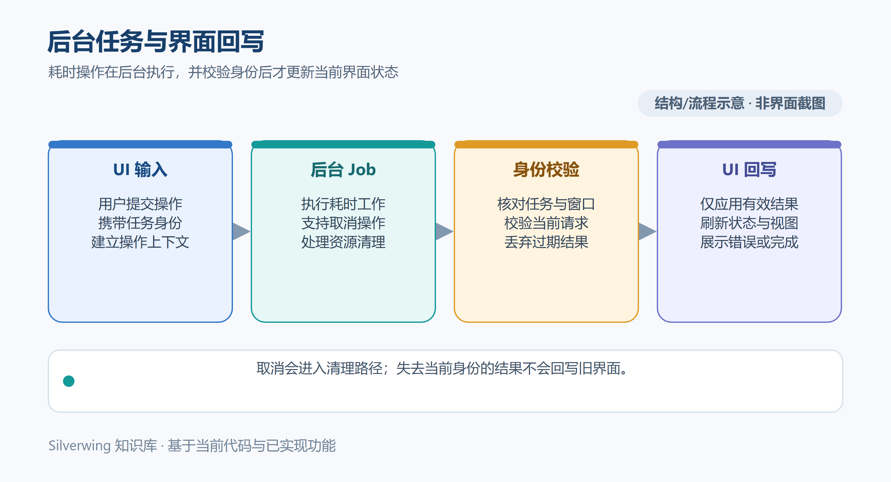

# 界面状态与异步操作

[← 知识库目录](../Index.md)

本文介绍桌面状态如何在窗口线程和后台工作之间流动，以及为什么不同操作有各自的并发和取消规则。核对日期：2026-10-19。

*示意图按当前实现绘制，不是应用截图。*

## 窗口线程负责界面状态

`internal/desktop` 中的 `app` 持有页面、选择、对话框、输入缓冲、缓存和操作展示状态。MyGO 的界面构建与这些状态变更属于窗口线程。耗时工作放到 goroutine 执行；完成后通过 `Window.Update` 把回调排回窗口线程，再检查当前页面、任务和请求身份，最后修改状态并请求重绘。

应用层提供进程内 `Snapshot` 和 `Dispatch` 边界，没有本地 HTTP 服务。快照包含任务、仓库、服务、Tag 历史和配置 JSON。桌面收到快照后通过 `applySnapshot` 更新数据投影、重选当前任务，并同步配置来源。一次后台操作是否刷新快照由具体 action 决定，读请求也可能只更新局部数据。

## 缓存、草稿与输入

`config_read_cache.go` 是窗口线程上的只读解析缓存：它按原始配置 JSON 字符串判断缓存是否仍匹配，分别解析当前编辑配置和后端快照配置。Tag 配置身份也从快照 JSON 计算。缓存返回值不作为编辑草稿；设置表单会从独立的数据副本构造草稿，因此改动输入不会反向修改缓存树。

文本编辑器由宿主持有状态和文档身份。普通任务文本的草稿、组合输入和保存状态独立于只读资料 Markdown；组件重绘不会重建现有 Buffer。普通文本自动保存有防抖，中文输入组合期间暂停落盘。任务切换、重命名、关闭标签和退出前会先回收当前输入，并核对保存失败或冲突，不能把“已排入保存”当成“已写入文件”。

重命名和任务根迁移还需要保存租约：桌面先捕获编辑状态，再让自动保存安静下来，避免目录移动与旧路径写入交叉。操作提交后按结果迁移草稿身份并释放租约；若迁移是否提交无法确认，则保留或暂停对应保存通道，等待恢复证据，避免向错误路径写入。

## 操作有不同的作业模型

普通 action 先由桌面层 `dispatch` 检查 `s.busy` 门闩，通过后才在后台调用应用层后端的 `Dispatch`。桌面创建 `context`，运行后端 action，必要时读取新快照，再把结果送回窗口线程。取消按钮取消这个 context；后台进程或清理流程确认退出前，操作状态仍可能保持忙碌。

不同操作的调度入口和结果状态并不相同。Tag、快捷命令以及设置页的配置备份/导入预览等在普通门闩前分流；单工作区合并仍走普通 action 门闩，只是卡片结果另外维护 token。配置 JSON 的解析缓存与设置页异步请求也不是同一机制，不能把下列机制概括成一套统一作业协议：

| 工作流 | 当前状态与回写方式 |
| --- | --- |
| Tag | `tag_job_state.go` 按 Home、任务根、任务 ID/路径/创建时间、配置身份和已确认账号建立 scope。快照有递增序号；切换 scope 会停止当前订阅，过期快照不会覆盖新页面。一个作业可以含多个 Tag 子项，也可另有 Genbu 检查状态。 |
| 工作区快捷命令 | 有全应用单一命令槽、自身 context 和输出流。请求捕获任务与工作区指纹、命令 token；输出和最终结果回到窗口线程并再次验身份。取消后槽位要等进程和清理完成才释放。 |
| 主分支合并 | 单工作区和批量合并都受普通 action 门闩约束。单工作区结果还用独立 token 关联任务和工作区，回写时比对路径、服务、模块和目标分支。失败或取消会清掉卡片状态并刷新 Git 状态；批量合并通过对话框选择后执行普通可取消操作。 |
| 配置 JSON 解析缓存 | 按 JSON 来源复用解析结果，是窗口线程上的同步只读缓存，不是后台 job，也不应据此推断配置保存成功。 |
| 配置备份/导入预览读取 | 在普通门闩前独立分流，按设置页 scope 管理异步请求；后台调用后端，再经 `Window.Update` 校验请求并回写。备份删除也复用这个作业管理器，但属于写操作，不是只读查询。 |

其他 CLI、资料文件、需求读取和工作区历史也有各自的请求键、取消函数或结果过滤条件。用户切页并不等于每个后端工作都停止；有些工作会继续运行，只是过期结果被丢弃。具体边界以相应模块为准。

## 失败与竞态边界

窗口关闭时，排队中的 `Update` 可能无法执行；各作业需要取消后台工作、等待清理或用不依赖界面状态的完成路径释放资源。取消是请求，不保证同步停止正在运行的本机原生函数。文件写入和任务目录迁移还会核对捕获的路径、基线和身份，避免慢请求覆盖用户后来打开的另一份文档。

排查“界面没刷新”时，依次确认操作是否进入后台、当前 token/scope 是否仍有效、窗口回调是否执行，以及结果是局部更新还是触发快照。排查“取消后仍忙”时，要看具体作业是否等待子进程树清理或保存租约，而不是只看取消按钮有没有响应。

## 源码入口

- 窗口状态和快照投影：`internal/desktop/data.go`
- action 分流、普通 busy 门闩与结果回写：`internal/desktop/actions.go`
- 配置只读解析缓存：`internal/desktop/config_read_cache.go`
- 设置页配置预览与备份作业：`internal/desktop/settings_config_recovery.go`
- Tag 状态、订阅和 action：`internal/desktop/tag_job_state.go`、`internal/desktop/tag_job_subscription.go`、`internal/application/tag_job_manager.go`
- 快捷命令作业：`internal/desktop/workspace_command_jobs.go`
- 单工作区合并状态：`internal/desktop/workspace_merge_ui.go`
- 自动保存与迁移租约：`internal/desktop/markdown_autosave.go`、`internal/desktop/markdown_task_root_dispatch.go`

相关文档：[任务与工作区数据模型](23-任务与工作区数据模型.md) · [配置持久化与恢复机制](24-配置持久化与恢复机制.md) · [常见问题与故障排查](../日常使用/08-常见问题与故障排查.md)
