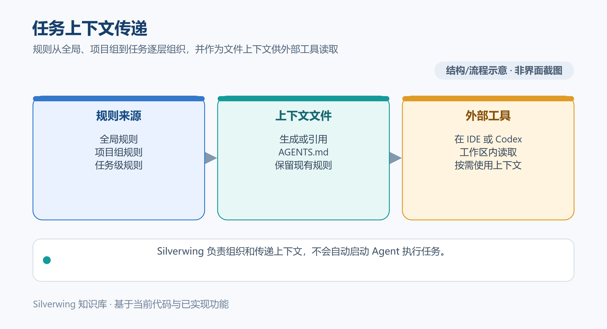

# 外部 CLI 与 Codex 集成

[← 知识库目录](../Index.md)

Silverwing 将 Git、Meegle、飞书和 Codex 等工具作为本机程序调用。本文按当前 Go / MyGO 实现说明调用边界；核对日期：2026-10-19。



*示意图按当前实现绘制，不是应用截图。*

## 统一的进程执行入口

调用方将程序路径、参数、工作目录和环境传给 `process.Spec`，由 `internal/process.Runner` 启动。参数是 `[]string`，不会先拼成一整条 shell 命令；Windows、macOS 和 Linux 的平台启动差异由 runner 处理。比如概念上的请求可以写成：

```go
process.Spec{
    Executable: "<已解析的 CLI 路径>",
    Arguments:  []string{"status", "--json"},
    Directory:  "<任务工作区>",
    Timeout:    30 * time.Second,
}
```

实际调用还可传入环境变量覆盖/移除项、标准输入、输出回调和 stdout/stderr 上限。未指定超时时默认十分钟；超时或取消会走子进程树终止与等待清理流程。输出上限可截断，也可配置为达到上限即停止进程。调用方应使用独立参数项，不要自行拼接带引号的命令字符串。

`executable.Resolver` 统一解析 Codex、Git、Lark 和 Meegle 命令。解析来源可能是用户配置、桌面应用位置、平台探测或 PATH 回退；结果按工具和配置路径缓存，也提供刷新探测。GUI 启动的 macOS 环境还会读取登录 shell 的 PATH。设置页的路径状态与来源有助于区分“程序未安装”和“当前图形进程找不到命令”。

## 团队 CLI 适配

Meegle 和飞书资料通过各自适配器调用外部 CLI，Silverwing 负责组装参数、设置工作目录/代理环境、限制超时、解析输出并映射为应用结果。CLI 缺失、退出码非零、输出不是预期结构、路径或登录身份变化，都会成为明确的错误或部分失败状态。不同适配器使用各自命令和输出格式；安装、登录参数应以工具发行说明和界面入口为准，不从本机猜测命令。

进程输出由 runner 收集并可逐行发给 UI。支持交互的流程使用同一进程生命周期和取消清理机制，而非另起一个常驻服务。错误展示会在适用路径上处理代理凭据等敏感值；诊断时仍应避免复制带令牌、个人目录或需求资料的原始输出。

## Codex app-server 与桌面深链

读取 Codex 配置、Skill 和会话列表时，Silverwing 解析 Codex CLI 后启动 `codex app-server --stdio`。它在任务目录作为 `cwd` 的本机子进程上通过 stdin/stdout 交换逐行 JSON-RPC 消息：先发送 `initialize`，成功后发出所需方法请求，读取对应响应。Silverwing 当前视图不接受 app-server 发起的交互式服务端请求；超时、CLI 退出或协议错误会返回失败，不会伪装成成功结果。

打开任务工作区时，Silverwing 检查工作区目录、已有线程绑定和 UUID，再调用系统 URI 处理程序打开 Codex 深链。新会话使用 `codex://threads/new?path=...`；已绑定会话使用 `codex://threads/<UUID>`。任务与线程的绑定保存在应用数据中，打开前会重新核验它仍属于当前工作区。外部 Codex 窗口及会话内容由 Codex 自己运行和管理。

Silverwing 可以生成任务路由说明和工作区上下文，让外部 Agent 看到任务范围与仓库路径；它不会在应用内自动并行运行多个 Agent，也不通过 HTTP 调用 Codex app-server。app-server stdio 会话用于明确的配置、Skill、会话等功能，不等同于“在内置 IDE 中启动 Agent”。

## 失败边界与排查

如果所有 CLI 都显示找不到，先检查可执行文件路径来源与图形应用继承的 PATH；若只有一个服务失败，再检查该适配器所用的工具、登录账号、工作目录和输出。长时间无响应应结合超时与 runner 清理结果判断，不能仅凭 UI 停止刷新就断定子进程已经退出。

Codex 会话列表为空时，确认任务 cwd、Codex 配置读取和 app-server 的初始化响应；深链打开失败时，确认系统已安装并注册 Codex URI 处理程序、路径为真实目录、线程 UUID 仍与该工作区绑定。Codex 未安装、CLI 与 app-server 协议不匹配、服务端返回错误或桌面 URI handler 缺失时，相关能力不可用，但本地仓库和工作区功能仍可独立使用。

## 源码入口

- 进程参数、环境、超时与清理：`internal/process/runner.go`、`internal/process/process_windows.go`、`internal/process/process_unix.go`
- CLI 解析和来源：`internal/executable/resolver.go`、`internal/platform/cli_resolution.go`
- 团队工具适配：`internal/integrations/cli.go`、`internal/integrations/meegle.go`、`internal/integrations/materials.go`
- Codex app-server stdio：`internal/platform/codex_rpc.go`
- Codex 线程绑定与打开：`internal/platform/codex_ai.go`、`internal/platform/codex_open_uri.go`
- 桌面任务入口：`internal/desktop/codex_ai_jobs.go`、`internal/desktop/task_workspace_ui.go`

相关文档：[IDE 与 Agent 配置](../AI%20工具与上下文/13-IDE与Agent配置.md) · [Codex 插件与 MCP](../AI%20工具与上下文/16-Codex插件与MCP.md) · [网络代理与 CLI 环境](../配置与数据/22-网络代理与CLI环境.md)
