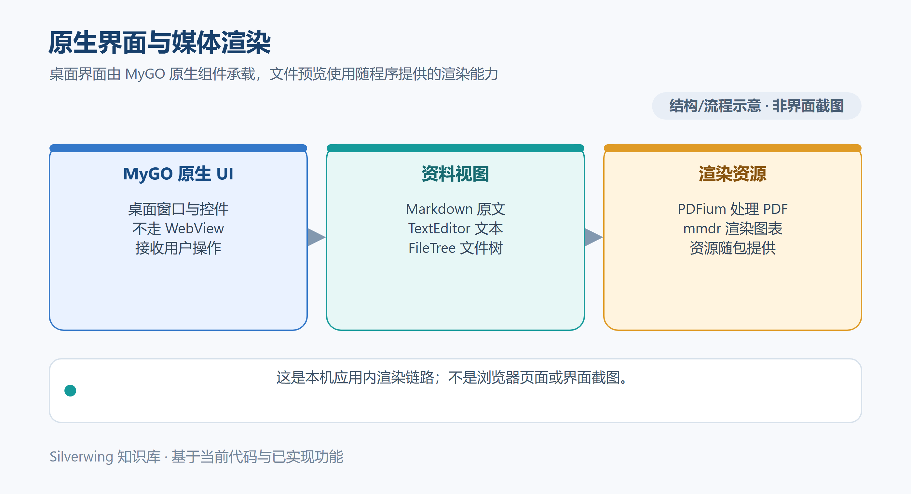

# 原生渲染与 MyGO 补丁

[← 知识库目录](../Index.md)

Silverwing 使用 Go 与 MyGO 原生桌面组件显示任务资料、源码、图片、PDF 和图表。本文聚焦组件职责和资源生命周期；核对日期：2026-10-19。

*示意图按当前实现绘制，不是应用截图。*

## MyGO 版本与本地源码

根模块在 `go.mod` 固定 `github.com/egoist/mygo v0.5.0`，同时用 `replace` 指向仓库内的 `third_party/mygo`。Silverwing 的原生输入和排版依赖这份本地源码，因此升级时除了更新版本号，还要检查本地扩展是否仍需要、与上游实现是否冲突。

补丁主要保留应用实际使用的契约：原生 TextEditor 的源码大小限制、组合输入通知、保留混合换行与剪贴板错误处理；Markdown 阅读器的原文映射、图片和链接回调；菜单命令派发、分栏比例、Windows 文件对话框错误，以及窗口缩放呈现。详细变更和升级检查点维护在 `third_party/MYGO-PATCHES.md`。该文件记录补丁目的，不代表每个运行环境都已完成实体设备验收。

## Markdown、TextEditor 与 FileTree

任务资料 Markdown 正文使用 MyGO `markdown.View` 和原生代码块布局，支持当前已接入的查找、选择复制、图片信任校验、链接和 Mermaid 预览。查看 Markdown 原文时，应用复用公共 TextEditor 的只读视图。任务资料 Markdown 不提供编辑或保存入口；代码库里存在 Markdown 编辑器实现，不能据此推断任务资料页面允许编辑。

公共 TextEditor 也用于普通 TXT、SQL、代码以及部分 JSON/CSV 源码编辑。宿主负责文档身份、输入回收、草稿、保存、冲突和权限；组件负责原生 Buffer、光标、选择、撤销、输入法和绘制。成功保存后继续复用现有 Buffer，避免输入位置或撤销状态意外重置。

FileTree 同样是展示和输入组件。任务资料与 Skills 可以复用它的文件行、展开和选择交互，但各自宿主仍决定目录如何构造、哪些文件可操作、菜单包含什么动作。共享组件的存在不改变资料类型的编辑权限。

## 图片、PDF 与 Mermaid 资源

图片在 Go 中解码，支持当前资料预览列出的格式，并将静态图像编码为 UI 使用的 PNG。PDF 通过 PDFium C API 与 `purego` 在本机渲染，不启动浏览器或 JVM。资料路径先由应用解析，媒体层还会检查普通文件、大小和格式边界。

打开 PDF 时，界面持有一个 `PDFDocument`，滚动时按需请求页面；每页 PNG 和文字索引用于显示、查找和选择。关闭预览或替换文件时，界面取消待处理请求并关闭文档，释放原始输入和页面缓存。PDFium 调用是同步原生操作，正在执行时不能被 context 中断；取消可以阻止后续工作或等待串行锁。PDFium 首次加载后在当前进程内保持同一库路径，缺库、损坏文件或密码保护 PDF 会返回错误。

Mermaid 使用随应用打包的 `mmdr v0.3.1` 本地程序。首次使用时，应用按平台从资源目录复制到版本化用户缓存；这一步不下载程序。渲染按源码与主题缓存结果，调用有 200 毫秒防抖和 5 秒超时，每次通过受限参数启动外部进程。切换文档、图表源码或主题时会取消旧请求；完成后还要匹配文档、图表 ID、源码/主题 key 和 context，过期 PNG 不会覆盖当前图表。缺少对应平台资源、超时、输出超限或图表语法错误会显示预览错误。

## 修改和排错

修改共享组件时先确认宿主交互是否依赖本地补丁，再对照 `third_party/MYGO-PATCHES.md` 中的上游升级检查点。资料 Markdown 出现空白或图表错误，先分辨是阅读器、受信图片加载还是 mmdr 子进程；PDF 错误则检查文件路径、资源库和 PDFium 错误信息。原生渲染失败会显示错误，不会自动回退到 WebView、网络渲染或另一个运行时。

## 源码入口

- MyGO 版本替换：`go.mod`
- 本地补丁说明：`third_party/MYGO-PATCHES.md`
- 公共 TextEditor 与 FileTree：`internal/desktop/text_editor.go`、`internal/desktop/file_tree.go`
- Markdown 阅读和 Mermaid 生命周期：`internal/desktop/markdown_ui.go`、`internal/editor/mermaid.go`
- PDF/图片媒体：`internal/media/pdf.go`、`internal/media/image.go`
- 预览打开、关闭与 PDFium 资源定位：`internal/desktop/native_media.go`

相关文档：[任务资料使用](../日常使用/11-任务资料使用.md) · [AGENTS 与说明模板](../AI%20工具与上下文/14-AGENTS与说明模板.md) · [技术架构总览](07-技术架构总览.md)
