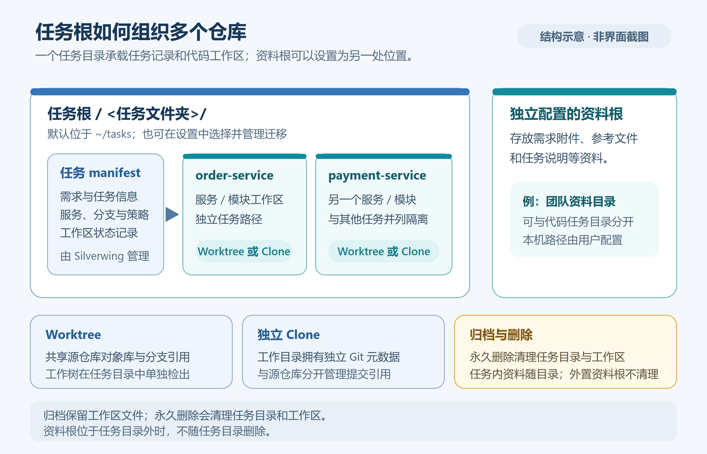

# 任务与工作区管理

[返回目录](../Index.md) · [上一篇：第一个多仓库任务](../入门与基础/05-第一个多仓库任务.md) · [相关：技术架构总览](../技术架构/07-技术架构总览.md)

本文以 Go / MyGO 版 Silverwing 当前实现为准，核对日期：2026-10-19。图示依据当前数据模型绘制，不是界面截图。



## 任务的组成

任务是一个清单目录和一个或多个 Git 工作区组成的整体。任务根目录下每项任务各占一个子目录；目录名来自创建表单中的任务名称，不能与已有任务目录重名。任务清单文件为 `silverwing.json`，记录需求链接、项目组、任务分支、生命周期状态，以及服务、模块和工作区策略。服务中的每个模块各对应一条工作区记录，因此一个任务可以跨多个仓库，也可以在同一服务下包含多个模块。

```text
<任务根目录>/<任务文件夹>/
├─ silverwing.json                 # Silverwing 任务元数据
├─ AGENTS.md                       # 任务级 Agent 路由说明
├─ .workspace/agent/
│  ├─ TASK-CONTEXT.md              # 需求、服务和允许修改范围
│  └─ TASK-RULES.md                # 本任务专属说明
├─ <服务名>-<模块名>/              # 对应模块的工作区
└─ ...
```

根目录 `AGENTS.md`、上下文和规则文件由 Silverwing 生成或管理。阅读任务上下文时不要手工改写 `silverwing.json` 或系统生成的上下文文件；需要调整任务说明时，在 **需求说明** 页签编辑，或按当前 Agent 规则维护相应内容。工作区目录名会按服务和模块名整理，具体路径以任务详情卡片显示值为准。

## Worktree 与独立克隆

| 策略 | 工作方式 | 使用时留意 |
|---|---|---|
| Worktree | 依托配置的本地仓库，创建额外工作目录；目录与原仓库共享 Git 对象库和分支 | 目标分支必填。现有分支会要求预检确认；同一分支已被另一 Worktree 检出时可能需要确认共享，锁定的 Worktree 不能自动复用。提交对象仍属于共享仓库。 |
| 独立克隆 | 从仓库配置的远程地址克隆到任务目录，形成独立 Git 仓库 | 目标分支可留空；留空时使用所选模块的基础远程分支。该克隆的本地分支和未推送提交独立于原仓库。 |

工作区策略在创建任务时按模块选择；一个任务可以混用 Worktree 与独立克隆。后来修改服务配置不会自动改变已经创建的工作区记录。需要新增模块时，从工作区卡片的 **添加模块** 操作进入；Silverwing 会把新增模块记录到任务清单中并准备对应目录。工作区出现失败或缺失状态时，先查看卡片上的提醒，再使用 **修复工作区** 或重试操作；不要直接在资源管理器中移动工作区目录，因为系统需要校验路径与 Git 身份。

## 查找与打开任务

任务列表有 **全部** 和 **最近访问** 两种视图，底部按钮可切换到 **查看归档**。搜索框可查任务名称、需求编号、需求标题或链接、项目组、分支和服务信息；输入多个词时，每个词都必须能在任务的可搜索信息中找到。当前任务列表与归档列表各自保留搜索和浏览状态。

打开任务行的右键菜单，可以置顶或取消置顶。全部视图中，置顶任务排在其他结果前面；最近访问视图按最近打开顺序显示最近 20 项。只有明确打开任务才会记为最近访问，刷新列表或在任务间切换分类不算一次访问。置顶和最近访问属于本地导航偏好，不会更改任务的需求、代码或生命周期。

键盘操作只在任务列表和搜索框聚焦时生效：

| 按键 | 操作 |
|---|---|
| 搜索框 `↓` / `↑` | 聚焦第一个 / 最后一个可见任务 |
| 搜索框 `Enter` | 打开第一个匹配任务 |
| 搜索框 `Esc` | 清空搜索内容 |
| 任务行 `↑` / `↓` | 聚焦上一项 / 下一项 |
| 任务行 `Home` / `End` | 聚焦第一项 / 最后一项 |
| 任务行 `Enter` 或 `Space` | 打开当前任务 |
| 任务行 `Esc` | 将焦点返回搜索框 |

当前没有任务时，任务页提示从需求列表创建任务；按[第一个多仓库任务](../入门与基础/05-第一个多仓库任务.md)从需求入口开始。

## 查看任务与 Git 状态

打开任务后，详情区包含 **任务详情、任务资料、需求详情、需求说明、Tag** 页签。任务详情列出每个服务模块的工作区卡片，卡片显示工作区路径、分支、健康状态和 Git 状态。路径、分支尚未验证时界面会标记未验证；先刷新 Git 状态，确认健康检查完成后再执行写操作。

在卡片中可查看本地未提交文件、当前分支相对主分支的整体差异和提交历史。整体差异默认查看已提交的分支改动；本地编辑可从 **本地未提交 N** 入口单独审阅，也可在整体差异页开启“包含本地未提交”。按服务逐卡确认比较范围、分支和变更后，再决定是否在 IDE、终端或 Silverwing 中提交、推送及合并。


> 这是 Windows 示例数据截图，用于定位状态与审阅入口；展示的任务和代码不属于你的工作区。

## 归档、恢复与永久删除

在任务行右键菜单中可使用 **归档任务**、**恢复归档** 和 **删除任务**。这些操作的影响不同：

| 操作 | 对任务目录和工作区的影响 | 任务列表变化 |
|---|---|---|
| 归档任务 | 更新任务生命周期状态；工作区、代码、任务说明和清单文件保留 | 从研发任务列表移到归档列表 |
| 恢复归档 | 将归档状态改回活跃状态；不重建或删除工作区，也不自动打开任务 | 回到研发任务列表 |
| 永久删除任务 | 删除任务目录及其工作区；不是归档。成功后任务清单和任务说明均不再属于 Silverwing 的任务目录 | 从活动和归档列表移除 |

归档前 Silverwing 会显示确认提示“任务将移至已归档，工作区和代码不会被删除”。恢复只改变生命周期分类。若归档期间某个工作区已被外部移动或删除，恢复任务不会因此重新克隆或重建工作区；请在任务详情检查健康状态，并单独修复工作区。

### 永久删除前先核对风险

风险清单不枚举被 `.gitignore` 等 Git 忽略规则排除的文件，但这些文件仍会随工作区或任务目录一起删除。即使清单为空，也应自行备份需要保留的 `.env`、本地数据和构建产物；不能把“没有列出风险”理解为目录内没有重要文件。

选择 **删除任务** 会打开风险检查窗口。Silverwing 会检查任务工作区的 Git 身份、路径和状态，并列出可确认的暂存、未暂存、未跟踪文件，以及独立克隆中的未推送提交风险。状态检查失败时不能继续删除，应先修复路径或 Git 身份并重新检查。进行中的 Git 操作也可能阻止安全清理；先完成或取消操作，再重新检查。删除检查不会替你决定代码是否可以丢弃。

继续前，按窗口提示关闭 Codex 中关联的项目或任务、IDE 中打开的工作区，以及文件管理器中打开的任务目录；Silverwing 不会替你关闭这些外部窗口。若检查发现风险，只有重新确认“确认丢弃未提交改动”后才能继续。进行中的 Git 操作或无法验证的工作区不能通过确认框绕过。

删除成功时，任务目录和被任务记录的工作区会被清理。Worktree 与独立克隆的数据归属不同：删除 Worktree 不会把共享仓库中的提交对象一并删除；删除独立克隆可能移除该克隆独有的本地分支或未推送提交。若清理过程中部分工作区备份无法移除，应用会报告残留路径；因此不要把永久删除理解为一定保留备份，也不要在未审阅风险时假定所有代码都能恢复。

任务资料使用 `RequirementMaterials.WriteRoot` 记录，通常位于单独配置的资料根目录下。永久删除逻辑只清理任务目录和清单中登记的工作区，不会另外按资料根配置去枚举或删除资料目录；如果你自行把资料目录放进任务目录内部，删除整个任务目录仍会一并移除其中的文件。

**删除前检查**：

1. 先查看每个工作区的未提交文件和未推送提交，并决定是否需要提交或推送。
2. 确认任务路径、模块和 Git 状态检查结果属于要删除的任务。
3. 关闭 Codex、IDE 与文件管理器中的相关窗口。
4. 仅在接受检查窗口所列风险后，勾选外部窗口已关闭及必要的丢弃确认，再执行永久删除。

## 下一步

继续阅读[技术架构总览](../技术架构/07-技术架构总览.md)，查看任务清单、工作区和桌面交互的职责边界。

具体操作可继续查阅[仓库与服务管理](09-仓库与服务管理.md)、[Git 差异审阅](10-Git差异审阅.md)；清单字段与状态关系见[任务与工作区数据模型](../技术架构/23-任务与工作区数据模型.md)。

[上一篇：第一个多仓库任务](../入门与基础/05-第一个多仓库任务.md) · [相关：技术架构总览](../技术架构/07-技术架构总览.md) · [知识库目录](../Index.md)

## 源码索引

- 清单与任务生命周期：`internal/storage/manifest_store.go`、`internal/domain/models.go`、`internal/workspace/task_application.go`
- 工作区与删除清理：`internal/workspace/provisioner.go`、`internal/workspace/lifecycle.go`、`internal/desktop/task_delete_dialog.go`、`internal/desktop/task_archive_dialog.go`
- 列表与导航：`internal/desktop/task_list_ui.go`、`internal/desktop/task_navigation.go`、`internal/desktop/task_context_menu.go`
