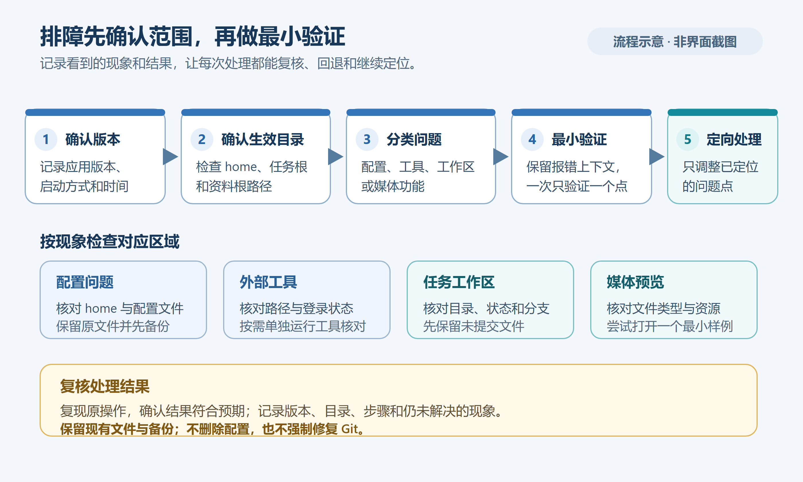

# 常见问题与故障排查

> 适用产品版本：Silverwing Go 0.0.1　｜　代码核对日期：2026-10-19

[返回目录](../Index.md) · [上一篇：技术架构总览](../技术架构/07-技术架构总览.md) · [相关：任务与工作区管理](06-任务与工作区管理.md)

先记下 Silverwing 版本、发生时间、当前页面、任务名称和错误原文。可在“设置 → 日志”刷新错误、复制错误信息或打开日志目录。日志位于应用数据目录的 `logs/application-YYYY-MM-DD.jsonl`；默认应用数据目录为 `<用户主目录>/silverwing`，若启动时用了 `--home`，则以该目录为准。需要协助时，在日志页的更多操作中选择“导出诊断信息”，通过保存对话框指定 ZIP 位置。诊断包包含系统与 CLI 状态、已脱敏的配置摘要、仓库 / Worktree 摘要及最近日志；转发前仍应检查日志内容，不要发送令牌、密码、授权码或其他凭据。

## 按现象排查

### Git 或其他 CLI 显示不可用

**现象：** Git、Meegle、Codex 或 Lark 提示找不到命令、无法启动或版本读取失败。

**检查：** Git 路径在“设置 → Git → Git 配置”；Meegle、Lark CLI 路径在“设置 → CLI”对应页面；Codex CLI 路径在“设置 → 任务 → 任务创建区”。查看命令状态、来源和解析到的路径。应用从桌面启动时获得的 PATH 可能与终端窗口不同。

**处理：** 在对应页面核对已保存的可执行文件路径，再刷新状态。非空路径会被直接尝试，刷新不会自动替换它；若路径失效，请清空路径后重新探测，或用文件选择器重新指定实际程序。使用“在终端中运行”核对解析出的命令。

**成功标志：** 页面显示命令可用并读到版本；相关操作能正常返回结果。

### Meegle 已登录但需求列表为空或项目不对

**现象：** “需求”页没有预期工作项，或链接打开了其他空间。

**检查：** 在“设置 → CLI → Meegle CLI”刷新状态，核对登录身份 / host；再检查“Meegle 项目空间”里的项目 Key、短名及默认 Sprint 项目。列表查询按配置的项目、Sprint 和当前登录用户参与关系筛选。

**处理：** 未登录时使用“登录 Meegle CLI”完成授权；修正 Key / 短名或默认项目后重新读取需求。列表为空也可能表示当前 Sprint 中没有符合参与条件的工作项。

**成功标志：** CLI 状态显示已登录，空间身份匹配，重新读取后出现预期工作项。不要把登录验证码或凭据放进工单。

### 创建任务时提示分支已被占用

**现象：** 目标分支已存在于本地、远端，或已由另一个 Worktree 检出。

**检查：** 重新运行任务创建预检，核对仓库、分支、占用该分支的 Worktree 路径，以及任务选择的服务 / 模块。

**处理：** 仅在确认这是要继续使用的分支时，按预检提示确认复用；状态发生变化就重新预检。若工作区锁定或属于其他任务，不要强制删除目录或清理 Git 元数据。

**成功标志：** 预检通过，任务清单指向正确工作区，任务详情显示预期分支。

### 工作区有未提交改动，或状态显示不健康

**现象：** 工作区卡片显示脏状态、分支不符、路径缺失或初始化警告。

**检查：** 在任务详情核对工作区路径、实际 / 期望分支和变更列表；需要时用 Git 差异审阅确认改动归属。

**处理：** 先在 IDE 或 Git 工具中保存、提交或妥善保留自己的改动。对可修复的问题点“修复工作区”，阅读实际分支、修复步骤和备份路径；只有预览允许修复且内容符合预期时才确认。初始化警告可使用卡片提供的 Bootstrap 重新执行入口。

**成功标志：** 修复结果显示完成，任务刷新后工作区路径和分支与任务清单相符；改动仍在预期位置。

### 任务创建失败，目录留下或工作区不完整

**现象：** 创建过程报错后，任务文件夹仍在，或只准备了部分仓库。

**检查：** 查看任务创建进度、错误详情及“设置 → 日志”。自动回滚未完成时，应用会为避免损坏 Git 元数据而保留目录供检查。

**处理：** 不要手工删除残留目录或 `.git` 内容。重新打开任务列表并刷新；若任务已登记，在对应工作区使用“修复工作区”预览。无法恢复时导出诊断包，并保留提示中的任务路径供定位。

**成功标志：** 若任务已恢复，所有预期工作区均已登记且可打开。若尚未恢复，只有在现场已保留、错误日志已导出并转交排查时，才算完成诊断取证；诊断包本身不代表任务已恢复。

### 启动时报配置 schema 不受支持或未知字段

**现象：** 启动错误包含配置版本 / schema 不支持，或当前程序不能识别配置字段。

**检查：** 核对当前 Silverwing 版本和最近是否切换过程序版本或配置目录。配置按当前 schema 严格读取，旧版程序不会自动忽略未知内容。

**处理：** 使用与现有配置相匹配的程序版本；如果应用能够打开，在“设置 → 存储 → 配置与备份”选择兼容的备份并确认恢复，恢复前应用会备份当前配置。导入外部配置 ZIP 时先查看导入预览；当前备份列表的恢复入口不提供差异预览。不要自行删除 JSON 字段、修改 schema、清空 `config/` 或删除锁文件。

**成功标志：** 应用正常进入主页面，仓库、任务根目录及集成设置均仍符合预期。

### 文本资料显示“文件有外部修改”或自动保存失败

**现象：** 编辑器提示外部版本与本地草稿冲突，或草稿缓存失败。

**检查：** 确认是否同时在 Silverwing 外编辑了同一文件；草稿缓存在应用数据目录 `cache/materials-text-drafts.json`，原文在任务资料目录。

**处理：** 先复制并核对本地内容。选择“使用磁盘版本”会丢弃当前草稿；选择“覆盖磁盘版本”会用本地内容替换外部修改，确认前先保存需要保留的双方内容。仅在普通保存错误且无冲突时点“重试保存”。

**成功标志：** 冲突提示消失，编辑器内容与磁盘文件一致，草稿状态已清除。

### PDF 打不开或 Mermaid 图表无法预览

**现象：** PDFium 加载失败，或 Mermaid 提示缺少离线渲染器。

**检查：** 确认使用与系统和芯片匹配的完整安装包，检查程序旁的 `resources` 目录是否完整；Windows x64 包含 `resources/native/pdfium.dll` 与 `resources/native-mermaid/windows-x64/mmdr.exe`。macOS 资源位于 `.app/Contents/Resources/`。

**处理：** 重新下载并完整解压 / 安装对应平台的 Silverwing 包，不要从其他版本拷贝单个动态库。问题仍在时从日志页导出诊断信息。

**成功标志：** PDF 可正常翻页、Mermaid 围栏块显示图表预览。

### macOS 首次启动被系统拦截，或 Windows 免安装版缺资源

**现象：** macOS 提示无法验证开发者；Windows 启动后 PDF / 图表资源缺失。

**检查：** 当前 macOS 包仅 ad-hoc 签名，未做 Developer ID 签名或公证；Windows 免安装包需要保留同级 `resources/`。

**处理：** 核实下载来源后，按需在 macOS“系统设置 → 隐私与安全性”允许打开。Windows 请重新完整解压 ZIP，运行 `silverwing/silverwing.exe`，并保持 `resources/` 与 EXE 同级。当前没有 Intel Mac、Windows ARM 或 Linux 安装包。

**成功标志：** 应用能够打开，资源预览正常。

### 搜不到任务，或准备删除任务

**现象：** 搜索没有结果，或担心删除任务会丢失改动。

**检查：** 搜索支持任务名、需求编号、项目组、分支，以及已读取的需求标题和关联服务；英文不区分大小写，空格分隔的词需同时匹配。确认当前在研发或归档列表，并检查任务是否已归档。

**处理：** 按 `Esc` 清空搜索并刷新列表，再核对“设置 → 存储 → 目录”中的任务根目录。删除前先检查工作区改动和未推送提交，并阅读删除风险确认。只是暂时移出研发列表时可先归档；不要在文件管理器中直接删任务目录。

**成功标志：** 搜索条件与列表分类正确；删除时已确认所列风险，完成后刷新列表不再显示该任务。归档任务可从归档列表恢复。

## 延伸阅读

备份和换目录见[备份恢复与迁移](../配置与数据/21-备份恢复与迁移.md)；命令路径和代理见[网络代理与 CLI 环境](../配置与数据/22-网络代理与CLI环境.md)；PDF、图表和编辑组件边界见[原生渲染与 MyGO 补丁](../技术架构/27-原生渲染与MyGO补丁.md)。

首次配置见[首次配置](../入门与基础/03-首次配置.md)，Meegle 授权与项目设置见[Meegle 接入](../入门与基础/04-Meegle接入.md)，工作区状态、修复和删除见[任务与工作区管理](06-任务与工作区管理.md)。源码依据：`internal/desktop/settings_environment_ui.go`、`internal/desktop/settings_cli_ui.go`、`internal/platform/diagnostics.go`、`internal/storage/config_store.go`、`internal/documents/material_text_drafts.go`、`internal/workspace/repair.go`、`../../docs/RELEASE.md`、`README.md`。

[上一篇：技术架构总览](../技术架构/07-技术架构总览.md) · [相关：任务与工作区管理](06-任务与工作区管理.md) · [知识库目录](../Index.md)
