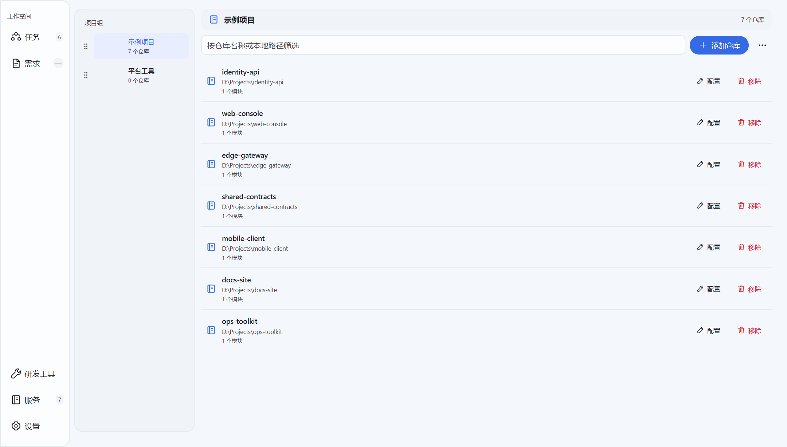

# 仓库与服务管理

[返回目录](../Index.md)

> 适用产品版本：Silverwing Go 0.0.1　｜　代码核对日期：2026-10-19

“仓库”指本机 Git 仓库及其路径、远程等身份信息；“服务”是项目组中对仓库的使用配置，包含显示名、工作区模块、默认分支、开发工具和初始化规则。一个项目组可以管理多个服务。仓库页面展示当前组，左侧组导航用于切换；右侧服务卡片可打开配置。服务配置不会替代 Git，也不负责克隆、拉取或切换原仓库的分支。

> 图片为 Windows 示例界面，名称、分组和路径均为演示数据。

## 管理项目组

进入左侧 **服务** 页面。通过组导航或右上角操作菜单可新建、重命名组，拖动调整组顺序；只有没有服务的空组可以删除。添加仓库时会把打开对话框时选中的组固定为目标，即使稍后切换页面，也不会误导入另一组。

示例：新建“支付平台”组后，将 `order-service`、`gateway` 两个本地仓库配置到该组。若某服务仍被任务引用，页面会阻止从组中移除；移除服务配置不是删除本地 Git 仓库，也不会改动已有任务。禁用服务可将它从之后的新任务选择中排除；保存后，页面会反映最新配置。

## 批量导入本地仓库

在目标组点 **添加仓库** → **选择目录…**，可一次选择多个本地 Git 仓库根目录，然后点 **添加所选仓库**。这是登记现有本地仓库，不是下载远程仓库。非 Git 根目录、重复选择、组内已添加的仓库会跳过；结果窗口列出“已加入”和“已跳过”的数量及原因。若同一 Git 仓库已经在其他组登记，当前组仍可建立自己的服务配置，但共享仓库身份不会被另行复制。

批量导入为新服务填入仓库名、启用状态、默认开发工具、单个 `default` Worktree 模块和空的 Bootstrap 规则。默认主分支按仓库识别出的远程默认分支生成，无法识别时回退到 `origin/master`。已有仓库配置不会被覆盖；如需调整模块、分支或工具，再点服务卡片的 **配置**。**成功检查：**结果窗口中的加入路径与所选目录一致，跳过项有可理解的原因，服务列表中能找到预期项目。

## 服务模块、主分支与初始化

服务配置弹窗侧栏包含 **基本信息**、**开发工具**、**Git**、**Genbu**、**工作区模块**、**复制规则**、**初始化命令**；默认工具在“开发工具”页设置，主分支在“Git”页的“分支与提交”区域设置。模块可有独立名称、工作区策略、快捷命令及分支覆盖；未填写模块主分支时继承服务主分支。分支写法为 `remote/branch`，例如 `origin/main`。下拉候选来自本地 Git 信息；展开或刷新候选可能读取远程分支信息。保存分支配置只改变 Silverwing 后续任务所用的基线，不会把仓库当前分支切换到该分支。

复制规则从服务仓库的相对路径复制文件到新工作区。初始化命令则在复制完成后按列表顺序执行：分别填写可执行程序、逐行参数、工作目录、超时和启用状态。参数逐项传递，不经过 Shell；路径须位于工作区内，不能使用绝对路径、`..` 或 `.git`。例如配置 `pnpm`，参数 `install` 与 `--frozen-lockfile`，工作目录 `.`，超时 `900` 秒。运行环境必须能找到该可执行程序。

导入仓库或保存配置本身都不会运行初始化命令。命令仅在工作区初始化流程中执行；工作区卡片的 **重新执行 Bootstrap** 会使用当前配置重跑复制规则与命令，可能覆盖已有目标文件、再次执行命令。点击前先检查当前工作区与规则，确认警告后再操作。**成功检查：**服务弹窗保存完成；新建任务时能选到启用的服务和模块；工作区初始化结果逐项显示复制或命令成功。不要仅凭“配置已保存”判断环境依赖安装成功。

## 源码索引

- 服务列表、组操作与批量导入 UI：`internal/desktop/replica_pages.go`、`internal/desktop/settings_groups_ui.go`、`internal/desktop/repository_batch_ui.go`
- 批量仓库识别与默认服务配置：`internal/application/repository_batch.go`
- 服务编辑器、模块与分支候选：`internal/desktop/service_editor.go`、`internal/application/repository_choices.go`
- 工作区准备与 Bootstrap 执行：`internal/workspace/provisioner.go`、`internal/workspace/bootstrap.go`、`internal/desktop/workspace_card_ui.go`

## 相关文档

[首次配置](../入门与基础/03-首次配置.md) · [第一个多仓库任务](../入门与基础/05-第一个多仓库任务.md) · [配置项参考](../配置与数据/19-配置项参考.md)
