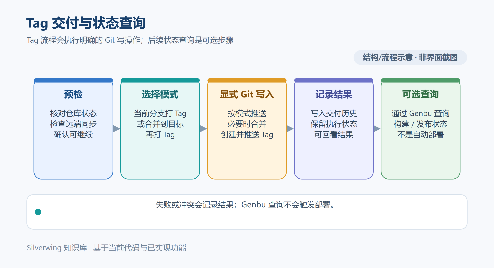

# Tag 交付

[返回目录](../Index.md)

> 适用产品版本：Silverwing Go 0.0.1　｜　代码核对日期：2026-10-19

Silverwing 的“构建测试 Tag”是一次受预检保护的 Git 写操作：按配置将代码合并到目标分支（或使用当前分支），创建并推送版本 Tag。它不在本机编译业务代码，也不代表 Genbu 构建或 UAT 发布完成。先看清操作目标，再发起任务。

> 示意图按当前实现绘制，不是界面截图。

## 前置配置

1. 在 **设置 → Git → Tag** 启用全局 Tag 能力；全局开关关闭时，服务和模块配置不会开放操作。
2. 在服务配置中为目标工作区模块启用 Tag，并选择交付模式。Tag 配置属于模块，不由服务组级开关控制；旧配置里的组级 `TagEnabled` 字段仅为兼容保留，不会决定能否执行。
3. 为模块选择目标分支。模块可继承服务的“测试 Tag 默认目标”（例如 `origin/release/test`），也可单独填写 `remote/branch`。该模块配置会在创建任务时写入任务清单；改服务配置不会追溯修改旧任务。允许编辑任务目标时，可在任务的 Tag 操作中调整后续目标；历史操作重试沿用该次记录的目标。

两种模式的差别在于被打 Tag 的提交：

| 模式 | 操作结果 |
| --- | --- |
| `MERGE_TO_TARGET_BRANCH`（合并到目标分支） | 同步源分支；必要时推送源分支；在隔离的临时工作区将源分支合并到配置的目标分支，并对合并后的目标提交打 Tag。 |
| `CURRENT_BRANCH`（当前分支） | 对当前源/功能分支打 Tag，并始终推送源分支；不会把改动合并到目标分支。 |

## 单模块交付

打开活动任务的工作区卡片，选择 **构建测试 Tag**，确认仓库、模块、当前分支、交付模式和目标分支后启动。点击后会自动预检并执行，不会再出现一个等待人工批准的独立“预检通过”确认步骤。

预检会核对任务与工作区身份、清单记录的分支、Git 仓库身份及远程地址，并要求工作区干净（包括暂存、未暂存和未跟踪文件）。合并/重放等 Git 操作进行中会阻止启动。随后读取远端分支与 Tag；如果远端源分支领先本地，流程会停止并要求先手动同步，不会替你拉取、变基或覆盖。目标分支只接受可安全快进或合并的结果；冲突会记录文件路径和原因并停止，需人工解决后重新发起。默认保护 `master`、`main` 等受保护分支，不能绕过保护继续写入。

例：虚构模块 `billing-api` 当前位于 `feature/REQ-DEMO-1001_refund-guard`，配置为 `MERGE_TO_TARGET_BRANCH`，目标是 `origin/release/test`。先检查该工作区无本地改动且源分支未落后，再启动。若预检发现远端已有更新，先在 IDE/Git 工具中按团队流程同步、审阅并确认工作区干净，再重新启动；不要把“自动拉取”当作 Tag 操作的一部分。

## 批量操作与记录

批量入口只列出当前任务中可执行的工作区和已启用 Tag 的模块；选择所需模块后，每个模块创建独立操作记录，并以同一批次 ID 关联。共享同一个 Git 仓库/远端的写操作会串行化，互不相关的仓库可独立执行。批量启动前逐项核对模块、源分支和目标分支，避免把某个服务的发布目标套用到整个服务组。

任务详情的 **Tag** 页展示每次操作的来源、目标、Tag 和状态；批量记录可按批次查看。操作明细位于任务目录的 `tag-operations/&lt;operationID&gt;.json`，摘要追加到 `tag-build-history.jsonl`，归属于该任务目录。历史记录的保留数量由设置控制（默认 3 组）；清理历史只清除本地记录，不会撤销远端 Git Tag，也不删除代码或资料。

界面历史中的“构建成功”容易与远程构建混淆：它表示本地 Git 操作已成功创建并推送 Tag，**不代表 Genbu 构建成功**。应继续核对同一条记录上的 Genbu **构建**和 **UAT** 状态。

当前 Tag 页没有逐任务的取消按钮。后端收到取消时，排队中的操作会在未执行 Git 写入前退出；正在运行的操作会尝试清理临时状态并记录结果，但已经发生的推送或 Tag 写入无法靠取消回滚。应用退出也会取消在途任务。若遇到中断，先查看 Tag 历史、远端分支和 Tag，再决定是否重试，避免重复打标。

**完成核验：**确认历史记录对应预期任务、服务、模块和目标；查看操作状态、Tag 名称及错误信息；必要时在远端仓库确认对应 Tag 指向的提交。再到 Genbu 状态区分别核验构建和 UAT，不把 Git Tag 成功当作发布完成。

## 源码索引

- 配置模型与策略：`internal/domain/models.go`、`internal/domain/policies.go`
- 设置和服务/模块编辑：`internal/desktop/settings_environment_ui.go`、`internal/desktop/service_editor.go`
- 单个与批量入口：`internal/desktop/tag_build_ui.go`、`internal/delivery/tag_jobs.go`
- Git 预检、合并、打 Tag 与取消：`internal/delivery/tag.go`、`internal/application/tag_job_manager.go`
- 历史界面与持久化：`internal/desktop/tag_history_ui.go`、`internal/delivery/tag_store.go`、`internal/delivery/tag_history.go`

## 相关文档

[仓库与服务管理](09-仓库与服务管理.md) · [Git 差异审阅](10-Git差异审阅.md) · [Genbu 接入](../外部集成/18-Genbu接入.md)
