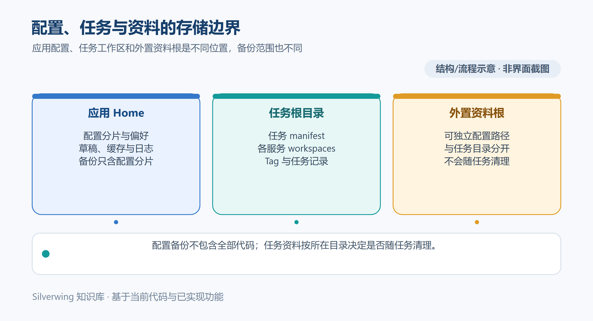

# 目录与数据存储

[返回知识库目录](../Index.md) · [配置项参考](19-配置项参考.md) · [下一篇：备份恢复与迁移](21-备份恢复与迁移.md)

本文按 Silverwing **0.0.1 Go / MyGO 版**当前实现整理，核对日期为 2026-10-19。图中路径为虚构示例。理解路径时先分清应用 Home、任务根目录和任务资料根目录：三者可以相同，但程序不会自动把它们合并。

## 三个根目录

| 名称 | 默认或来源 | 主要内容 |
| --- | --- | --- |
| 应用 Home | `~/silverwing`；可由启动参数 `--home` 指定 | Silverwing 配置、备份、日志、桌面状态、缓存、Silverwing 管理的 Codex 扩展数据 |
| 任务根目录 | 首次初始化时为 `~/tasks`，之后取应用配置中保存的 `taskRoot` | 每个任务的目录、清单、任务说明和任务工作区 |
| 任务资料根目录 | 在「设置 → 存储 → 目录」配置 `requirementMaterialsRoot`，并填写子目录后启用 | 按需求整理的资料文件；每个任务的清单还会记录该任务实际资料写入路径 |

例如，同一台 Windows 电脑上的三个位置可能是 `C:\Users\Dev\silverwing`、`D:\silverwing-tasks` 和 `E:\team-materials`。示例只用于说明关系，不要求建立这些目录。

`--home` 只选择应用 Home。首次初始化的任务根目录由系统用户家目录单独得到，因此更换 Home 不会自动更换 `~/tasks`；已有配置也会保留原先设置的任务根目录。把 Silverwing 以另一个 Home 启动，并不代表任务和工作区也已隔离。

## Home 中保存什么

Home 下最重要的是 `config/`。当前配置按用途分为 8 个 JSON 分片：`layout.json`、`workspace.json`、`services.json`、`tag.json`、`tools.json`、`git.json`、`integrations.json` 和 `appearance.json`。例如任务根路径保存在 `workspace.json`，仓库和服务配置分散在 workspace/services 等分片中。程序还会在 `locks/` 保存配置锁，在 `temp/` 暂存文件。

其它常见位置如下：

| 路径 | 用途 |
| --- | --- |
| `desktop-preferences.json` | 窗口尺寸、任务列表宽度、设置页位置、导航栏折叠等桌面显示偏好 |
| `task-navigation.json` | 任务置顶及最近访问等导航偏好 |
| `cache/reading-state.json` | 任务选择、资料阅读位置等本地阅读状态 |
| `cache/materials-markdown-drafts.json`、`cache/materials-text-drafts.json` | 资料 Markdown 和普通文本的未保存草稿 |
| `cache/markdown-drafts/` | 其它 Markdown 文档的草稿缓存 |
| `codex/` | Silverwing 管理的 Codex 关联、扩展状态、Skill 来源缓存和恢复副本 |
| `agents/` | Silverwing 全局说明、项目组说明及任务说明模板 |
| `logs/application-YYYY-MM-DD.jsonl` | Silverwing 应用事件日志，设置中的日志页可读取或清理 |
| `backups/silverwing-config-*.zip` | 配置导出包及配置改写前自动生成的回滚备份 |
| `diagnostics/` | 默认诊断压缩包的保存位置；也可在导出时选择其它位置 |

Codex 自身的用户配置通常在 `CODEX_HOME/config.toml`；未设置 `CODEX_HOME` 时，代码按用户家目录下的 `.codex/config.toml` 查找。任务工作区还可能有项目级 `.codex/config.toml`。这些是外部 Codex 配置，不等于 Home 下的 `codex/`，也不会放进 Silverwing 配置 ZIP。它们由 Codex 配置层和 MCP 管理流程读取或更新。

## 任务根目录中的数据

任务根目录下每个有效任务占一个子目录，清单名为 `silverwing.json`。任务说明和 Agent 上下文也在这个任务目录中；各服务模块的 Worktree 或独立克隆通常位于任务目录之下。Tag 操作记录属于对应任务：`<任务目录>/tag-operations/<操作ID>.json` 保存详细状态，`<任务目录>/tag-build-history.jsonl` 保存历史摘要。任务归档只改变生命周期状态，数据仍留在原目录。

打开任务详情后，可从卡片菜单复制任务路径；也可以在「设置 → 存储 → 目录」核对当前任务根。手工移动任务目录会使保存的工作区路径与 Git 身份失配，宜使用设置中的任务根迁移流程。

## 任务资料根目录

资料根目录和资料子目录都填写后，Silverwing 才会在创建需求任务时准备资料路径。目录结构按「资料根 / 需求 ID-任务目录名 / 资料子目录」生成。例如虚构需求 `REQ-1001`、任务名 `库存调整`、子目录 `研发`，可能落在 `E:\team-materials\REQ-1001-库存调整\研发`。任务清单会保存实际的 `WriteRoot`，资料页使用这个清单路径，因此后续更改全局资料根不会自动搬动旧任务资料。

可从任务的「任务资料」页查看当前资料目录，也可用目录菜单打开或复制路径。若更换资料根，先复制所需的外部资料，再在「设置 → 存储 → 目录」更新根目录和子目录；逐个检查旧任务的资料路径仍可用。

## 日志与诊断包

应用事件日志按日期写入 Home 的 `logs/`。诊断导出包含系统和 CLI 检查摘要、脱敏配置摘要、仓库与 Git Worktree 摘要，以及最多 3 个近期应用日志；它不是任务目录、资料目录或仓库的完整备份。导出前仍应确认所选路径和日志内容适合分享。

要查找某类数据，先在设置中确认应用 Home，再分别查看当前任务根和资料根；不要仅因文件不在 Home 下就判断数据丢失。

## 相关阅读

- [配置项参考](19-配置项参考.md)
- [备份恢复与迁移](21-备份恢复与迁移.md)
- [任务与工作区数据模型](../技术架构/23-任务与工作区数据模型.md)

源码索引：`cmd/silverwing/main.go`、`internal/application/app.go`、`internal/storage/paths.go`、`internal/storage/config_store.go`、`internal/storage/manifest_store.go`、`internal/desktop/preferences.go`、`internal/desktop/reading_bridge.go`、`internal/desktop/task_navigation.go`、`internal/documents/markdown_drafts.go`、`internal/platform/mcp.go`、`internal/platform/extensions.go`、`internal/delivery/tag_store.go`、`internal/delivery/event_log.go`、`internal/platform/diagnostics.go`。
