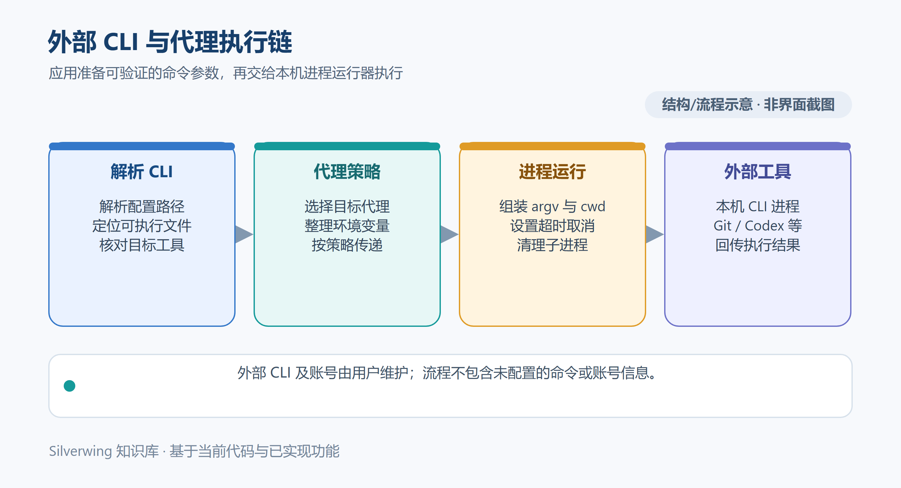

# 网络代理与 CLI 环境

[返回知识库目录](../Index.md) · [上一篇：备份恢复与迁移](21-备份恢复与迁移.md) · [配置持久化与恢复机制](../技术架构/24-配置持久化与恢复机制.md)

本文说明 Silverwing 如何解析 Git、Codex、Meegle 和 Lark 命令，以及如何配置 Codex CLI 的代理。示意图中的命令和路径均为虚构例子。

## CLI 可执行文件从哪里来

解析结果按当前实现遵循下列顺序；设置中已有非空路径时，不会再用 PATH 里的另一个版本替代：

1. **读取 Silverwing 设置中的可执行文件路径**。Git、Codex、Meegle、Lark 的非空配置路径均直接优先使用，不会因为该路径失效而继续自动探测其他位置。
2. **执行平台探测**。Windows 上使用 `where.exe` 查询命令位置；Codex 还会检查 Codex 桌面应用的安装目录。macOS 使用登录 `zsh` 执行 `command -v`，Linux 使用登录 `bash`。命令名称分别是 `git`、`codex`、`meegle` 和 `lark`。

路径解析后，Silverwing 运行 `--version` 检查命令；成功的自动发现路径会写入配置，后续优先使用这个已保存路径。状态页的重新检测可刷新状态及探测缓存，但不会替换设置中非空的路径。无论该路径来自手工选择还是先前自动发现，路径失效时都会继续尝试它并报告失败；请清空路径以重新探测，或重新选择有效的可执行文件。

因此桌面应用看到的 PATH 不一定与另一个终端窗口相同。macOS 下由 Finder 启动时，Codex 和 Meegle 子进程会通过登录 `zsh` 获取 PATH，并合并命令所在目录、登录 PATH 与应用继承的 PATH；该登录 shell 查询最长等待 3 秒。Windows 的 Codex 额外检查桌面应用目录；其它平台没有同样的桌面 Codex 探测特例。若刚安装或更新 CLI 后状态仍旧，先核对已保存的路径是否失效，再决定清空重探测或重新选程序；仍不可用时检查应用启动时继承的环境。

## 在设置中验证命令

- Git：打开「设置 → Git 与发布 → Git 环境与写保护」，查看命令状态和版本；路径留空表示由程序探测。
- Meegle：打开「设置 → 工具与连接 → 命令行与账号」的 Meegle 页签，查看安装、版本和登录状态。
- 在「设置 → 工具与连接 → 命令行与账号 → Codex」核对 Codex CLI 状态。

不要因为终端里可以输入命令就认定桌面应用能找到同一个程序。Silverwing 的版本检测实际启动子进程；目录存在、PATH 中看见一项或登录状态缓存都不能代替状态页的成功结果。CLI 安装和登录依团队发行版说明完成，不要在这里照抄其它机器的绝对路径或凭据。

## 命令代理设置

打开「设置 → 工具与连接 → 网络代理 → 网络代理」。选择 HTTP、HTTPS 或 SOCKS5，分别填写主机和端口；地址不能带用户名密码、路径、查询参数或片段。需要认证时单独启用代理认证，并同时填写账号与密码。例外地址以逗号分隔，只填写主机、IP 或通配符，不写协议。

在「代理目标」启用 Codex CLI 后，Codex AI 命名和 Codex app-server 使用配置的代理。

表单变更会自动保存到 Silverwing 配置。页面上的「测试代理」只尝试连接代理主机和端口，超时为 3 秒；它不验证 HTTP 响应、代理账号密码是否有效、目标服务能否访问，也不等同于某个 CLI 的登录检查。测试前等待配置保存完成，再分别运行相关工具的状态检查。

## 子进程环境与继承

Silverwing 启动 Git、服务快捷命令、Meegle CLI 和 Codex CLI 时，会移除继承的 `HTTP_PROXY`、`HTTPS_PROXY`、`ALL_PROXY`、`NO_PROXY` 及其小写版本。启用 Codex CLI 代理后，程序会为 Codex 进程注入设置里的代理变量与例外地址。代理错误会隐藏配置中的地址和账号。

该规则仅作用于 Silverwing 启动的受控命令，不会改写 Windows、macOS 或 Linux 的用户/系统环境，也不会改变已打开的终端、IDE 或正在运行的进程。保存设置后，新启动的受控命令读取新配置；已运行的命令继续使用启动时拿到的环境。普通终端从父进程继承的 PATH 和代理变量也不由此设置页改变。

## 超时、取消与排查

每种操作有自己的超时时限：版本检测通常为 10 秒，Meegle 状态检查为 15 秒，服务快捷命令使用该命令配置的秒数；没有单独时限的通用进程默认最长 10 分钟。取消操作或超时会触发子进程清理，并在 Windows 或 Unix 平台结束对应进程树；清理失败会作为错误返回，不应当作命令已停止。

排查时依次确认：设置中的 CLI 版本检查成功；命令路径属于 Silverwing 当前进程可访问的位置；需要代理的目标已勾选；例外地址没有误匹配；测试代理 TCP 连通后，再运行具体 CLI 状态检查。不要通过修改系统级环境变量来绕开 Silverwing 的目标隔离；若代理或命令配置刚保存，启动一次新的检查以验证实际子进程结果。

## 相关阅读

- [首次配置](../入门与基础/03-首次配置.md)
- [配置项参考](19-配置项参考.md)
- [外部 CLI 与 Codex 集成](../技术架构/26-外部CLI与Codex集成.md)

源码索引：`internal/executable/resolver.go`、`internal/platform/cli_resolution.go`、`internal/platform/cli.go`、`internal/platform/exec.go`、`internal/networkproxy/policy.go`、`internal/workspace/custom_command.go`、`internal/process/runner.go`、`internal/desktop/settings_environment_ui.go`、`internal/desktop/settings_save_proxy.go`、`internal/domain/models.go`、`internal/domain/validation.go`。

## Lark CLI

在「设置 → 工具与连接 → 命令行与账号 → Lark」可检查命令和当前账号。Lark 使用自身的网络配置。Windows npm 版使用同一 `@larksuite/cli` 安装内的原生 `lark-cli.exe`。
