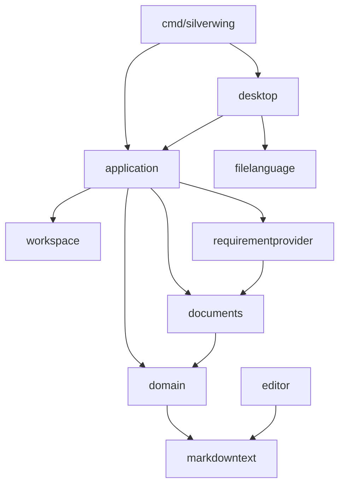

# 产品版架构

silverwing-product 是基于 Go 与 MyGO 的原生桌面工作台。`cmd/silverwing` 启动任务、资料、需求、设置与工具界面，通过进程内应用接口调用业务，无本地 HTTP 服务、WebView 或 JVM。产品版任务沿用普通目录生命周期，不创建开发版工作区。

## 代码与依赖方向

| 包 | 职责 |
| --- | --- |
| `cmd/silverwing` | 参数解析、组装应用与桌面入口 |
| `internal/desktop` | MyGO 视图与输入、功能 controller/state、窗口适配和异步结果回写 |
| `internal/application` | 进程内操作边界、typed 请求与结果、Snapshot、服务组装和兼容 Action 路由 |
| `internal/domain` | 持久模型、枚举和业务规则；依赖纯文本/值模块，不依赖编辑器、界面或基础设施 |
| `internal/workspace` | 普通目录任务生命周期、资料同步、任务根迁移、AGENTS 生成与 Codex 打开 |
| `internal/documents` | 资料目录与权限、文件操作、准备计划、读写及草稿；消费需求来源接口 |
| `internal/requirementprovider` | `Meegle` 适配器；执行远端 CLI、解码响应并实现 `documents.RequirementProvider` |
| `internal/editor` | 编辑器运行时 part ID、查找/撤销、Mermaid 和自动保存状态；保留纯 Markdown API 的兼容包装 |
| `internal/markdowntext` | Markdown AST、源区间、表格、围栏、阅读投影及评论图片算法；仅使用标准库与 Goldmark |
| `internal/filelanguage` | 中性的语言枚举、文件名映射和源码编辑覆盖规则 |
| `internal/asyncjob` | 与业务、窗口无关的作业登记、取消、完成、等待和关闭后回写门禁 |
| `internal/productprofile` | 本分支固定的名称、edition、默认目录、安装标识和发布渠道 |
| `internal/media` | PDFium、图片与媒体资源 |
| `internal/integrations` | 需求列表、内容、评论、身份与缓存；资料准备协议由 requirementprovider 适配 |
| `internal/platform` / `internal/executable` / `internal/process` | 本机能力、可执行文件发现与外部进程运行 |
| `internal/storage` | 配置分片、任务清单、锁、原子写入、备份与恢复 |
| `internal/tools` | JSON、时间、文本对比和端口操作 |
| `internal/architecture` | 仅用标准库解析源码，检查明确的职责依赖方向 |



## 功能单元与应用边界

`desktop` 在同一包内按功能持有显式 controller 和私有 state。任务、资料、需求、设置和工具分别由 `taskController`、`materialsController`、`requirementController`、`settingsController`、`toolsController` 管理；controller 不保存 `*app`、窗口、Backend 或通用宿主，只通过窄 view/cleanup ports 协作。功能状态与已拆分的取消、停止、等待清理方法由对应 controller 拥有；仍需窗口能力的方法通过窄 ports 调用。

原生窗口、渲染入口、Snapshot 合并、跨功能协调和反馈仍由 `app` 负责，少量视图桥接方法委托 controller。当前边界没有把所有 render 方法移出 `app`，也没有把每个文件变成独立 Go 包。

| 单元 | 已形成的边界 | 保留的兼容或宿主责任 |
| --- | --- | --- |
| Markdown 与语言 | `markdowntext` 提供纯源文本算法；`filelanguage.Language` / `FromPath` / `SourceEditorOverride` 提供中性语法映射 | `editor` 保留运行时状态与原 API 包装，workspace 的旧语言 API 保留 alias / wrapper |
| 资料与任务组装 | `RequirementProvider.Resolve` / `Title` 注入需求事实；`TaskApplicationDependencies` 和 `NewTaskApplicationServiceWithDependencies` 显式注入任务协作者 | 默认适配器和具体服务的选择集中在 composition；旧构造入口保留兼容 |
| 应用操作 | `TaskCreator` / `TaskLifecycle` / `TaskMaterials` / `TaskTools`、`DeveloperTools`、`RequirementReader` 提供 typed 消费接口和 `OperationResult[T]` | `Action` / `Dispatch` 保留兼容及动态 CLI、扩展路由；已有入口委托相同业务方法 |
| 桌面功能 | controller 持有功能 state 与局部生命周期 | app 保留渲染、原生窗口和跨功能协调 |
| 异步基础 | `asyncjob.Group` / `Lease` 负责登记、关闭、取消和等待，`Post` 只接受窄排队函数 | 已接入 `tool_jobs.go` / `cli_jobs.go`；资料屏障、账号身份与不可取消操作策略仍由调用方处理 |
| 产品身份 | `productprofile/current.go` 是本分支唯一的固定身份源 | 三个分支仍按原功能边界裁剪，不提供运行时 edition 切换 |

`DescribeAction(kind)` 的 `ActionDescriptor` 集中表达标签、任务菜单作用域、刷新、反馈、专用结果与取消属性。描述符供呈现和调度使用，不替代业务操作、路径授权或后台身份校验。

资料树、快速查找、右键目标和复制路径消费独立的文档投影与选择值模型，显式传入根目录、文档、排序和展开状态。树的可见范围、快速查找的原始遍历顺序、文件操作的后代去重及复制路径的完整选择分别保留各自规则。实际文件操作仍在应用与资料层核对任务、目录身份和权限。

typed 请求在兼容转换时保留捕获的任务路径、创建时间、配置与资料身份。任务变更仍在原有锁和校验边界内重新核对上下文；界面上可见或 Snapshot 中可写，不等于执行时已经获权。

## 资料来源与权限

`documents.PreparationService` 负责本地计划、身份核对、锁和文件写入，通过 `RequirementProvider` 获取来源身份与标题。Meegle 的命令、超时、参数和 JSON 解码集中在 `internal/requirementprovider/meegle.go`，documents 不构造远端需求命令。

`documents.MaterialsDescriptor` 统一提供 `Kind`、`ReadRoot`、`OwnedRoot`、`TemporaryRoot`、`CanWrite`、`CanSync` 及 `Readable` / `Writable` 判定。`application.MaterialsPermissions` 是该类型的 alias，Snapshot 暴露经过身份核对的瞬态描述，不改变任务清单格式。

本分支仅启用 ANNUAL 资料布局。共用描述类型保留 LOCAL 枚举，不表示产品版接受本地独立资料布局。NONE 或身份无法确认的描述不授予写入、同步权限。后台文件操作仍重新读取任务、配置和资料 scope，再检查路径、锁与摘要；Snapshot 描述不能作为授权凭据。

产品版没有开发版工作区、交付 controller 或对应业务能力；共用模块不会重新启用已裁剪的功能。

## 编辑与持久化

MyGO 固定为 v0.5.0，使用 `third_party/mygo` 的本地源码。输入法、字体回退、菜单、剪贴板和绘制由框架负责；本地补丁见 [MYGO-PATCHES.md](../third_party/MYGO-PATCHES.md)。

资料与 Skills 复用 FileTree 的展示与输入组件。普通文本和代码复用 TextEditor；宿主持有文档身份、草稿、权限、保存和冲突状态。成功保存不重建 Buffer。普通资料文本上限为含 BOM 的 3 MiB，开发工具单个输入上限为 2 MiB。

Markdown 使用 MyGO `markdown.View` 与 `DefaultCodeBlock` 只读阅读，原文预览使用只读 TextEditor。普通阅读不加载或改写 Markdown 草稿，不提供 Markdown 编辑与保存；纯算法拆分没有改变该边界。详见 [TEXT-EDITOR-AND-FILE-TREE.md](TEXT-EDITOR-AND-FILE-TREE.md)。

普通文本保留 UTF-8 BOM 和混合换行，使用 `materials-text-drafts.json` 与 650ms 防抖自动保存，组合输入期间暂停落盘。写入前重新验证任务及资料身份、根目录、普通文件、符号链接或 junction 和基线摘要，再原子替换；失败或冲突保留草稿。

配置保存使用锁、分片提交与恢复日志。设置输入由 UI 线程合并并串行保存，回显保护尚未提交的输入。任务根切换提供迁移、直接切换和取消，只有确认后的业务操作改变目录。

资料请求捕获任务、目录与文档身份，过期结果不能覆盖新页面。切换、重命名、删除及退出仍由相应功能的输入回收、保存租约与屏障协调。阅读位置缓存仅用于浏览位置和选区，不作为文件内容或草稿来源。

## 异步生命周期

`asyncjob.Group.Begin(ctx, Options{CancelOnClose: ...})` 返回 `Lease`。lease 提供 Context、Cancel、Done、Complete、Err 和 Wait；Complete 幂等。Group 的 Close 禁止新登记，并取消被标记为可取消的作业，Wait 等待登记作业完成并保留清理错误。

`Group.Post` 不依赖 MyGO，只接受 `func(func()) bool` 排队函数。关闭后拒绝入队，已经排队的回调在执行时再次检查关闭状态。窗口适配器仍负责确认回调、检查视图/任务/账号身份、处理失效窗口以及操作是否允许取消；公共 tracker 不自动替换现有请求或授予执行权限。

当前共享生命周期已接入三版 `desktop/tool_jobs.go` 与 `desktop/cli_jobs.go`：Begin / Complete 取代通用运行登记，Close + Wait 管理退出登记边界与后台清理。工具端口终止保持隐藏、关闭时不取消；CLI 仍先执行后端原子取消变更，再取消并等待轮询。当前请求、token、home/path/账号身份及授权变更的退出约束保留在桌面适配器，资料屏障与保存租约保留原生命周期。

## 性能单元与失效边界

展示缓存由功能 owner 持有，按明确发布版本失效，不参与执行授权。JSON 共享原文坐标索引、投影与搜索结果；资料目录共享不可变 catalog、排序与路径索引；任务列表通过数据版本复用过滤投影，并只构建可见行。相同 slice 内容改变后仍需重新发布，任务搜索的项目组标签通过独立版本发布，异步需求元数据通过 setter 发布独立值。

`SnapshotFor` 只读取页面需要的任务和 Skills 集合，原 `Snapshot` 保留完整读取。设置页只在 home/config 相同的情况下合并最新 UI 集合；配置变化时回退完整读取。任务定点读取继续在磁盘上验证目录、清单、schema 与创建身份，展示缓存不替代这些检查。

外部读取复用显式操作的短生命周期会话：Codex 一次操作共用一个 app-server；需求图片批次共享有界字节缓存，但每条评论保留各自的权属、后置身份核验与 sidecar。没有跨账号的 URL 全局缓存或隐式写入重放。

PDF 按页让出全文索引执行权，渲染队列只保留当前页面需求；图片通过有界加载池共享不可变结果。进程内预览采用独立 RGBA，PNG API 保持可用。Markdown 预览作业登记到现有 `asyncjob.Group`，关闭先取消再等待实际清理；每个 app 的 Mermaid 初始化 owner 在这些作业之后关闭。媒体预算与不可中断的 native 阶段见 [NATIVE-MEDIA.md](NATIVE-MEDIA.md)。

## 产品身份与数据隔离

`internal/productprofile/current.go` 只保存本分支的字面量身份，`profile.go` 提供默认目录、edition 检查和发布渠道函数。`buildinfo.ProductName` 保留兼容 alias。配置或数据迁移不由 profile 自动执行。

| 分支身份 | 默认 home | 默认任务根 | 默认资料根 | 持久 edition |
| --- | --- | --- | --- | --- |
| Silverwing | `~/silverwing` | `~/tasks` | 未配置 | 沿用无 edition 的开发版格式 |
| silverwing-qa | `~/silverwing-qa` | `<home>/tasks` | `<home>/materials` | 严格校验 `qa` |
| silverwing-product | `~/silverwing-product` | `<home>/tasks` | `<home>/materials` | 严格校验 `product` |

Go 运行时与安装资源以 `internal/productprofile/current.go` 为固定产品身份的唯一来源：Windows 构建使用 `scripts/product-profile.ps1`，macOS 的 `scripts/build-macos.sh` 使用本机 sed 读取；原生构建不新增 Python 依赖，`scripts/product_profile.py` 用于 CI 标签校验和发布脚本。`CurrentProductVersion` 仍定义在 `internal/domain/models.go`，CI 使用 profile 的发布前缀校验版本标签。现有各版触发范围、安装标识与发布目标保持各自原有边界。

产品版配置、任务、缓存、阅读状态和日志以应用 home 为根。显式 `--home` 同时隔离默认任务和资料目录；配置和任务清单严格检查 product edition，没有开发版数据自动迁移路径。

## 自动化依赖门禁

```shell
go test ./internal/architecture
```

该命令只用标准库读取源码 AST，不启动桌面、不执行外部 CLI，也不递归调用 go test。检查覆盖 `internal` 下全部非 `_test.go` 源文件，包括其他 GOOS 和未启用 build tag 的文件；排除 testdata、vendor、隐藏目录和嵌套模块，因此 Windows 与 macOS 上判定相同。

- domain 不反向依赖 editor、application、desktop 或基础设施；本模块内只消费 domain 和纯模块。
- markdowntext、filelanguage、asyncjob、productprofile 不依赖业务或框架；markdowntext 单独允许 Goldmark。
- application 不依赖 desktop 或 MyGO。
- documents 不依赖具体 requirementprovider、integrations 或远端进程协议。media、storage、本机剪贴板/回收站依赖保持合法；直接字面量远端 CLI 入口另有 AST 检查。
- 声明公共 TextEditor 与语言映射入口的源码不依赖 workspace，使用 filelanguage；检查不要求三版使用相同文件名。

门禁用独立 fixture 验证违规 import、合法消费者、平台文件、来源适配器和本机命令边界。它不做全程序数据流或运行时授权分析，也不限制文件行数、接口数量和功能规模；业务测试及真实桌面验证仍按变更风险执行。

`.github/workflows/native-build.yml` 在已有 Windows x64 / macOS arm64 构建矩阵的 Go 设置之后运行该门禁。原生构建、打包、上传和发布步骤保持原有流程；打包与许可证要求见 [RELEASE.md](RELEASE.md)，PDF 与图表边界见 [NATIVE-MEDIA.md](NATIVE-MEDIA.md)。
